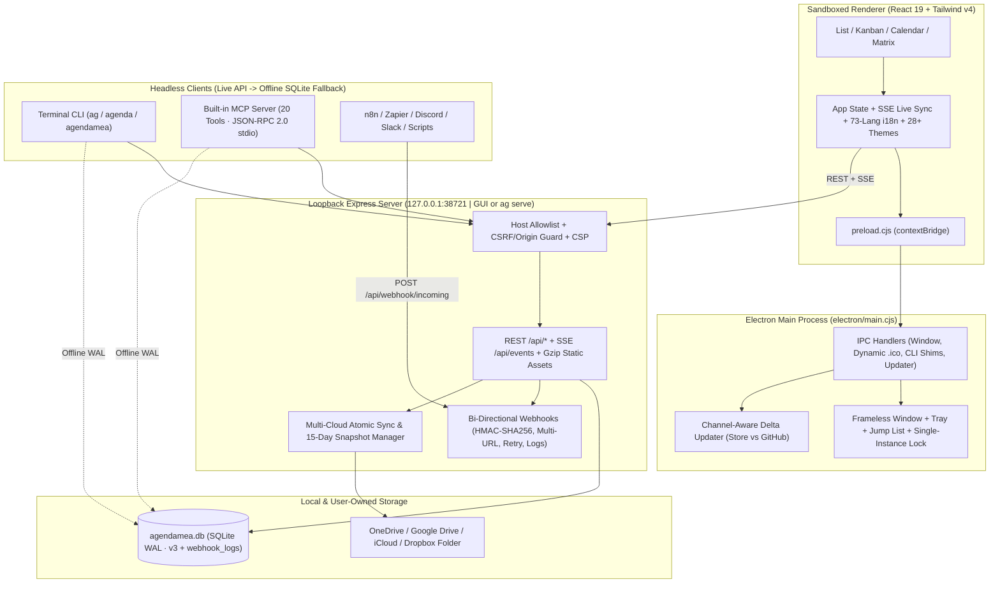

<div align="center">

<a href="https://vellium.dev" target="_blank" rel="noopener noreferrer">
  
</a>

<br /><br />

#  Agendamea - Local-First Windows Task Manager, CLI &amp; MCP Automation

</div>

---

<div align="center">

[](#english-version)
&nbsp;&nbsp;&nbsp;&nbsp;
[](#turkish-version)

</div>

---

<div align="center">

[](https://github.com/emirtdede/agendamea/actions/workflows/ci.yml)


</div>

---

<a id="english-version"></a>
# English Version

<div align="center">
  <picture>
    <source media="(prefers-color-scheme: dark)" srcset="public/logos/agendamea-mark-dark.svg" />
    
  </picture>
  <h3>Agendamea - Fast, Local-First Windows Task Manager &amp; Headless Automation Suite</h3>
  <p><em>4-Way Planning Views, Built-in 20-Tool MCP Server, Short Terminal CLI (ag), Headless Webhook Daemon, Zero-Cost Multi-Cloud Sync, Custom HEX Themes, Dynamic App Icons &amp; 73 Languages</em></p>
  <p><strong>Developed &amp; Published by <a href="https://vellium.dev">Vellium</a></strong></p>
</div>

<br>

##  Project Overview

**Agendamea (`v1.0.0`)** is a local-first, offline-first daily task manager and automation suite built for **Windows Desktop (Electron 45)** and **PWA** environments with **React 19**, **TypeScript 7**, **Express 4**, and **WAL-mode SQLite (`better-sqlite3`)**. Every change - tasks, optional start/due date ranges, due times, `#tags`, subtasks, auto-saving notes, categories, drag-and-drop order, and settings - saves instantaneously to your device with zero accounts, subscriptions, or external telemetry.

It goes far beyond a standalone checklist. For developers, power users, and AI coding agents, Agendamea ships with **100% headless control** even when the desktop window has never been opened: a **short quote-free terminal CLI** (`ag`, `agenda`, `agendamea`), a **built-in 20-tool Model Context Protocol (MCP) server** (`ag mcp`), a **headless local API & webhook daemon** (`ag serve`), **bi-directional HMAC-SHA256 webhooks** (Discord, Slack, n8n, Zapier, Make, custom servers) with multi-URL retry and persistent delivery logs, and **live SSE UI synchronization**.

For effortless cross-device backup without vendor lock-in or server costs, Agendamea provides **Zero-Cost Multi-Cloud Folder Sync** across **OneDrive**, **Google Drive**, **iCloud Drive**, **Dropbox**, or any custom folder with atomic temp-file swaps, **15-day rolling daily backups**, automatic corrupt-primary fallback, and reinstall recovery.

> **Documentation:** architecture, keyboard shortcuts, 73-language localization, release process, and Microsoft Store packaging checklists are indexed in [`docs/README.md`](docs/README.md).

---

##  Key Features

###  4-Way Workspace Views & Daily Planning
- **Flat List View**: Smart views (`All`, `Today`, `Important`, `Completed`), custom categories with 8 curated colors + custom spectrum HEX picker, pinning, instant search across titles/notes/subtasks/`#tags` with automatic **Date Range filtering**, and drag-and-drop or `Alt+Up/Down` keyboard ordering.
- **Kanban Board**: Group tasks dynamically by **Priority** (`High`, `Normal`, `Low`) or **Status** (`Active`, `Completed`) with drag-and-drop transitions and optional drag lock protection.
- **Calendar Planner**: Monthly calendar grid with chronological `HH:mm` time sorting per day, multi-day date spans, and a collapsible **Undated Tasks** drawer supporting drag-to-schedule directly onto dates.
- **Eisenhower Matrix**: Automatic 4-quadrant classification (`Q1 Urgent & Important`, `Q2 Important`, `Q3 Urgent`, `Q4 Later`) with drag-and-drop reprioritization across quadrants.
- **Rich Task Details**: Optional start/due date ranges (`YYYY-MM-DD`), optional due times (`HH:mm`), post-creation `#tag` management (batch entry, deduplication, 12-tag limit, instant chip filtering), inline subtasks, and auto-saving notes with `keepalive` unmount flush.

###  Built-in 20-Tool MCP Server, Short Terminal CLI (`ag`) & Headless Daemon
- **20-Tool Built-in MCP Server (`mcp/server.cjs` / `ag mcp`)**: JSON-RPC 2.0 over stdio for **Claude Desktop**, **Cursor**, **Antigravity**, **Windsurf**, and **VS Code** - works with zero external Node.js installation via bundled `Agendamea.exe` (`ELECTRON_RUN_AS_NODE=1`) in both **Live API** and **Cold-Start Offline SQLite** modes.
- **Short Quote-Free Terminal CLI (`ag` / `agenda` / `agendamea`)**: 1-click PATH installation (`Terminale Kur` in Settings or `ag install` headlessly), numbered 1-2-3 lists, natural token parsing (`@today`, `@tomorrow`, `@YYYY-MM-DD..YYYY-MM-DD`, `14:30`, `!`, `*`, `^`, `#tag`, `/Category`, `--note`, `--sub`), batch operations (`ag ok 1 2 3`, `ag rm 1 2`), stdin piping (`ag import -`, `ag +`), terminal views (`ag cal`, `ag kanban`, `ag matris`), and raw `-j` / `--json` output.
- **Headless Background Daemon (`ag serve start|stop|status`)**: Run the local `127.0.0.1` REST API, SSE stream, and incoming webhook listener in the background without opening the Electron GUI window.
- **Bi-Directional Webhooks (Multi-URL, Retry, HMAC-SHA256 & Logs)**: Automatic Discord (`content`), Slack (`text`), and generic JSON notifications across all task/subtask/category/trash/reset events with 2-attempt retry, event filtering (`webhookEvents`), persistent SQLite `webhook_logs` (`ag hook logs`), and a full-featured incoming trigger (`POST /api/webhook/incoming`) supporting both `X-Agendamea-Secret` and `X-Agendamea-Signature` HMAC verification.

###  Self-Healing SQLite Engine, Advanced Trash & Clean Start
- **WAL-Mode SQLite (`better-sqlite3`)**: Runs with `journal_mode = WAL`, `synchronous = NORMAL`, `foreign_keys = ON`, `busy_timeout = 5000`, and versioned migrations (`PRAGMA user_version = 3`).
- **Corruption Self-Healing**: If a local database file is damaged by power loss, Agendamea preserves the broken file as `.corrupt-<timestamp>.bak` and initializes a clean database automatically.
- **Searchable Trash Bin & 12-Second Undo**: Soft-deleted tasks and categories support instant search, type filters (`All`, `Tasks`, `Categories`), sorting (`Newest`, `Oldest`, `A-Z`, `Z-A`), and deletion date-range filtering, paired with a **12-second hover-pausing Undo toast**.
- **Atomic Backup, Restore & Clean Start Reset**: One-click JSON export (`/api/export`), 5 MB validated atomic import (`/api/import`), and a 2-step **Reset All Data (Clean Start)** action with optional settings reset (`/api/reset`).

###  Zero-Cost Multi-Cloud Folder Sync
- **Automatic Multi-Provider Detection**: Auto-detects **OneDrive**, **Google Drive** (including virtual drive letters `D:`-`Z:` and localized names), **iCloud Drive**, and **Dropbox** (`info.json`), or connects to any custom local/network folder.
- **Crash-Safe Atomic Writes & 15-Day Rolling History**: Uses atomic `.tmp` rename swaps, preserves `agendamea-onedrive-previous.json`, keeps **15 rolling daily snapshots**, and automatically falls back if a primary sync file is interrupted.
- **Reinstall Recovery Banner & Headless Cloud Pull**: Detects existing cloud backups on fresh installs to prompt **Restore Backup** vs **Start Fresh**, plus headless `ag sync auto|set|pull|status` support.

###  28+ Theme Palettes, Custom HEX, Dynamic App Icons & 73 Languages
- **14 Dual-Mode Themes + Custom HEX Theme Generator**: `Obsidian`, `Slate`, `Navy`, `Blue`, `Cyan`, `Indigo`, `Purple`, `Pink`, `Red`, `Orange`, `Yellow`, `Emerald`, `Grass`, `Lime`, plus unlimited **Custom HEX (`#RRGGBB`)** themes with one-click copyable HEX badges, WCAG AA contrast tokens, and anti-FOUC caching.
- **Dynamic System-Wide App Icons**: Match theme automatically or choose Monochrome Dark/Light, any palette color, or a **Custom HEX icon** - synchronized live across the BrandMark, main window, Windows taskbar, system tray, Jump List, and Desktop / Start Menu shortcuts (`.lnk`).
- **Full-Page Tabbed Settings & 7-Step Welcome Guide**: Split-navigation Settings covering *Appearance & Theme*, *Accessibility* (`80%-150%` zoom, High Contrast, Reduced Motion), *General & Language* (Windows startup, global `Ctrl+Alt+N` quick add, close-to-tray behavior), *Data & Backup*, *Trash*, *Documentation* (CLI/MCP/Webhooks/Shortcuts), and *Updates & Legal*.
- **73 Fully Localized Languages (Zero Leakage)**: Upfront multi-language Windows Setup `.exe` selector, OS locale auto-detection, full **RTL** mirroring (`ar`, `fa`, `he`, `ur`), and 5 offline localized legal documents.

###  Hardened Localhost Security & Zero-Cost Delta Auto-Updates
- **Loopback Isolation & CSRF Defense**: Binds exclusively to `127.0.0.1` (`38721` / `47821` with Hyper-V/WinNAT `EACCES` fallback), enforces Host DNS-rebinding checks, validates `Sec-Fetch-Site` and `Origin` on mutations, and applies strict security headers (`CSP`, `nosniff`, `SAMEORIGIN`, `no-referrer`).
- **Native Electron 45 Shell & Delta Updater**: Single-instance lock with portable handoff, `contextIsolation: true`, `nodeIntegration: false`, `sandbox: true`, external URL allowlist (`vellium.dev`, `github.com`), SHA-512 verified `electron-updater` silent/delta updates on GitHub builds, and strict Microsoft Store Policy 10.2.7 isolation (`!process.windowsStore`).

---

##  Tech Stack

<div align="center">


</div>

### Desktop & Local Backend
- **Electron 45.4 & electron-builder 26.18** - Frameless Windows desktop shell, system tray, Jump List, global `Ctrl+Alt+N` hotkey, dynamic `.ico` generator, NSIS installer, Portable build, and Microsoft Store `.appx`/MSIX packaging
- **Express 4.21 & Node.js 22+** - Loopback REST API (`127.0.0.1`), SSE live change stream (`/api/events`), bi-directional HMAC webhooks, multi-cloud folder sync, and in-memory gzip static delivery
- **better-sqlite3 13.2** - High-throughput synchronous SQLite WAL engine with `user_version` migrations, `webhook_logs`, and `.corrupt-*.bak` self-healing

### Headless Automation, CLI & MCP
- **`shared/localStore.cjs`** - Unified Live-API + Cold-Start Offline SQLite engine with automatic schema init, cloud auto-detection, OS preference bridge, and headless daemon management
- **`cli/agendamea.cjs` (`ag` / `agenda` / `agendamea`)** - Zero-dependency natural-language terminal CLI with Windows interactive stdout wrapper (`run-cli.ps1`)
- **`mcp/server.cjs` (`ag mcp`)** - Built-in JSON-RPC 2.0 stdio MCP server exposing 20 complete headless tools

### Frontend, Build & Release
- **React 19, TypeScript 7, Tailwind CSS v4 & Vite 8** - Modular component architecture with Workbox PWA support and 73-language compact locale builder
- **Node.js `node:test` via `tsx`** - 31 comprehensive unit, security, i18n zero-leakage, webhook, CLI, MCP, and performance test suites
- **GitHub Actions & `electron-updater`** - Automated CI (`ci.yml`) and tagged Windows release pipeline (`release.yml`) with `latest.yml`, `.blockmap`, `SHA256SUMS.txt`, and `winget` manifests

---

##  Project Structure

```tree
Agendamea/
├── .github/workflows/
│   ├── ci.yml                       # Automated tests, TypeScript lint & production build gate
│   └── release.yml                  # Tagged Windows x64 Setup, Portable, Store .appx, latest.yml & SHA256SUMS
├── assets/
│   ├── vellium-banner.svg           # Monochrome Vellium header banner
│   └── icons/                       # Monochrome 20x20 documentation SVG icons
├── cli/
│   └── agendamea.cjs                # Short quote-free CLI (ag / agenda / agendamea) + daemon & views
├── mcp/
│   └── server.cjs                   # Built-in JSON-RPC 2.0 stdio MCP server (20 headless tools)
├── shared/
│   ├── localStore.cjs               # Unified Live API + Cold-Start Offline WAL SQLite engine
│   ├── cliInstaller.cjs             # Shared Windows PATH shim installer (ag.cmd + run-cli.ps1)
│   └── releaseUtils.cjs             # Shared SemVer comparator & GitHub release parser
├── docs/                            # Indexed architecture, i18n, release & Microsoft Store documentation
├── electron/
│   ├── main.cjs                     # Electron main process, tray, Jump List, IPC, CLI shims & delta updater
│   ├── preload.cjs                  # Context-isolated renderer IPC bridge
│   └── iconGenerator.cjs            # Pure-Node multi-resolution Windows .ico & .lnk updater
├── electron-resources/              # Multi-language NSIS installer.nsh, BMPs, icons & APPX tiles
├── public/                          # PWA manifest icons, Windows tiles & Agendamea SVG/PNG marks
├── scripts/                         # esbuild server bundler, icon & NSIS bitmap generators
├── winget/manifests/                # WinGet 1.6.0 manifests (Vellium.Agendamea 1.0.0)
├── src/
│   ├── api/client.ts                # Typed REST API client
│   ├── components/                  # Workspace views, Detail panel, WelcomeModal, Settings tabs & Docs
│   ├── db/database.ts               # TodoDatabase (SQLite WAL, migrations, CRUD, reset, webhook_logs)
│   ├── hooks/                       # useOnlineStatus, useToast, useTodayDate, useDelayedFocus
│   ├── i18n/                        # 73-language catalog, compact builder, RTL & 5 legal documents
│   ├── utils/                       # themes.ts, todoLogic.ts, todoLogic.test.ts (31 suites)
│   ├── App.tsx                      # Root state, SSE external sync listener, shortcuts & layout
│   └── types.ts                     # Shared domain models
├── server.ts                        # Express loopback API, SSE stream, bi-directional webhooks & cloud sync
├── electron-builder.yml             # Windows NSIS, Portable & Microsoft Store APPX packaging config
├── CHANGELOG.md                     # Version history
├── LICENSE                          # MIT License (Vellium Teknoloji Anonim Sirketi)
└── package.json                     # Scripts, bin (agendamea) & v1.0.0 metadata
```

---

##  Architecture & Security Boundaries



**Security model.** The renderer never receives Node.js access (`contextIsolation: true`, `nodeIntegration: false`, `sandbox: true`). External links are restricted to an explicit domain allowlist (`vellium.dev`, `github.com`). The embedded Express API listens exclusively on loopback (`127.0.0.1`), enforces Host DNS-rebinding checks and `Sec-Fetch-Site` / `Origin` CSRF guards, validates incoming webhooks with constant-time `X-Agendamea-Signature` HMAC-SHA256 verification (`crypto.timingSafeEqual`), caps import payloads at `5 MB`, and performs all file/database writes atomically without collecting telemetry.

---

##  Storage & Security Schema

| Path / Boundary | Protection | Contents |
| :--- | :--- | :--- |
| `%APPDATA%\Agendamea\agendamea.db` | SQLite WAL, `foreign_keys = ON`, `.corrupt-*.bak` recovery | `categories`, `todos`, `subtasks`, `settings`, and `webhook_logs` tables (`user_version = 3`) |
| `%APPDATA%\Agendamea\runtime-port.json` | Loopback port discovery & headless PID metadata | Active local API port for live CLI/MCP routing |
| `%APPDATA%\Agendamea\dynamic-icons\` | Generated multi-resolution `.ico` & tray `.png` | Active system-wide custom/themed Agendamea icons |
| `%LOCALAPPDATA%\Agendamea\bin\` | User-scoped PATH shims (no UAC required) | `ag.cmd`, `agenda.cmd`, `agendamea.cmd`, and `run-cli.ps1` |
| `<CloudFolder>\Agendamea\` | Atomic `.tmp` swap, 15-day rolling backups, corrupt fallback | `agendamea-onedrive-sync.json`, previous & daily snapshots |
| Loopback API (`127.0.0.1`) | Host allowlist, CSRF/Origin guard, HMAC-SHA256 webhooks, CSP | Local REST CRUD, `/api/events` SSE, `/api/webhook/incoming`, cloud sync |

---

##  CLI & Built-in MCP Server Usage

### Terminal & PowerShell CLI (`ag` / `agenda` / `agendamea`)

Install once via **Settings -> Documentation -> Install CLI (`ag`)** or headlessly via `node cli/agendamea.cjs install`:

```powershell
# List active tasks numbered 1, 2, 3 (works with GUI open OR closed!)
ag

# Add a task naturally without quotes (date range, time, priority, important, pin, tags, category, subtasks)
ag + Prepare launch deck @2026-11-22..2026-11-25 14:30 ! * ^ #store /Work --sub "Verify MSIX"

# Inspect full task details, complete multiple tasks in one command, or restore from Trash
ag show 1
ag ok 1 2 3
ag undo

# Terminal planning views (Calendar agenda, Kanban board, Eisenhower Matrix)
ag cal
ag kanban
ag matrix

# Headless local API & incoming webhook daemon (receive n8n/Zapier/curl webhooks without opening GUI)
ag serve start
ag hook set https://discord.com/api/webhooks/... my-hmac-secret
ag hook logs

# Auto-connect cloud folder, export/import backups (supports stdin pipe), or check updates
ag sync auto
ag export backup.json
ag update
```

### Model Context Protocol (MCP) Server (`ag mcp` - 20 Built-in Tools)

Add Agendamea to **Claude Desktop**, **Cursor**, **Antigravity**, **Windsurf**, or **VS Code** (no global Node.js required):

```json
{
  "mcpServers": {
    "agendamea": {
      "command": "ag",
      "args": ["mcp"]
    }
  }
}
```

<details>
<summary>View all 20 built-in MCP tools</summary>

`agendamea_status` · `agendamea_list_tasks` · `agendamea_get_task` · `agendamea_add_task` · `agendamea_update_task` · `agendamea_complete_task` · `agendamea_pin_task` · `agendamea_delete_task` · `agendamea_clear_completed` · `agendamea_manage_subtask` · `agendamea_list_categories` · `agendamea_manage_category` · `agendamea_list_trash` · `agendamea_manage_trash` · `agendamea_eisenhower_matrix` · `agendamea_views` · `agendamea_get_settings` · `agendamea_update_settings` · `agendamea_backup_and_sync` · `agendamea_webhook_and_server`

</details>

---

##  Installation & Usage

### Installing as an End User (Windows)

1. Download **`Agendamea-Setup-1.0.0-win-x64.exe`** (or portable **`Agendamea-Portable-1.0.0-win-x64.exe`**) from [GitHub Releases](https://github.com/emirtdede/agendamea/releases), or install via the [Microsoft Store](https://apps.microsoft.com/detail/9MT5X1NGZJXZ).
2. Run the setup file. **No administrator (UAC) elevation is required** - it installs per-user (`asInvoker`, `perMachine: false`) into `%LOCALAPPDATA%\Programs\Agendamea`.
3. Select your language in the multi-language Vellium setup wizard and choose your install directory.
4. Launch **Agendamea** from the Start Menu or Desktop shortcut (or run `ag` from any terminal after installing the CLI shim).

**SmartScreen on unsigned direct downloads:** For direct GitHub downloads outside the Microsoft Store, Windows SmartScreen may show "Windows protected your PC" on first run. Select **More info -> Run anyway**. The Microsoft Store package is signed by Microsoft and installs without SmartScreen prompts.

**Uninstall:** Windows Settings -> Apps -> Agendamea -> Uninstall. Local user data under `%APPDATA%\Agendamea` is preserved by default (`deleteAppDataOnUninstall: false`) with an interactive choice in the custom uninstaller.

### Prerequisites (Building from Source)
- **Windows 10 (1809+) or Windows 11** (64-bit) for desktop builds (or Linux/macOS for web/PWA development)
- **Node.js 22+** and **npm**
- **Git**

### Run from Source

```bash
git clone https://github.com/emirtdede/agendamea.git
cd agendamea
npm install

# Run Web + API dev server or Electron desktop app
npm run dev
npm run electron:dev
```

### Tests & Quality Gates

```bash
npm test          # 31 unit, SQLite, security, 73-language, CLI, MCP & webhook E2E suites
npm run lint      # Strict TypeScript type-check (tsc --noEmit)
npm run build     # Production Vite frontend + esbuild server bundle
```

### Build Windows Installers

```bash
# Windows x64 NSIS Setup + Portable builds (release/)
npm run dist:win

# Microsoft Store APPX/MSIX package (release/)
npm run dist:win:appx

# Unpacked verification build (release/win-unpacked/)
npm run dist:win:dir
```

---

##  Distribution Packages

Build artifacts are produced under `release/`:

- **NSIS Setup Installer** - `Agendamea-Setup-1.0.0-win-x64.exe` (with `.blockmap` & `latest.yml` for silent delta updates)
- **Portable Executable** - `Agendamea-Portable-1.0.0-win-x64.exe`
- **Microsoft Store Package** - `Agendamea-Store-1.0.0-win-x64.appx`
- **Unpacked Build** - `release/win-unpacked/` via `npm run dist:win:dir`
- **Checksums & WinGet** - `SHA256SUMS.txt` and `winget/manifests/v/Vellium/Agendamea/1.0.0/`

Published builds and release notes are available on the [GitHub Releases](https://github.com/emirtdede/agendamea/releases) page.

---

##  License & Publisher

**MIT License.** Copyright © 2026 **Vellium Teknoloji Anonim Şirketi**.

See [`LICENSE`](LICENSE) for the full MIT license text. Distributions delivered through the Microsoft Store are also subject to the Microsoft Store Standard Application License Terms.

- **Publisher:** Vellium Teknoloji Anonim Şirketi ([Company Information](https://vellium.dev/en/legal/company-information))
- **Official Website & Product Links:** [vellium.dev](https://vellium.dev) &bull; [GitHub Repository](https://github.com/emirtdede/agendamea) &bull; [Microsoft Store](https://apps.microsoft.com/detail/9MT5X1NGZJXZ)
- **Legal Hub:** [Privacy Policy](https://vellium.dev/en/legal/privacy) &bull; [Terms of Service](https://vellium.dev/en/legal/terms) &bull; [Support Policy](https://vellium.dev/en/legal/support) &bull; [Security Disclosure](https://vellium.dev/en/legal/security-disclosure) &bull; [KVKK Notice](https://vellium.dev/en/legal/kvkk-notice)
- **Official Emails:** General [contact@vellium.dev](mailto:contact@vellium.dev) &bull; Support [support@vellium.dev](mailto:support@vellium.dev) &bull; Privacy [privacy@vellium.dev](mailto:privacy@vellium.dev) &bull; Legal [legal@vellium.dev](mailto:legal@vellium.dev) &bull; Security [security@vellium.dev](mailto:security@vellium.dev) &bull; Billing [billing@vellium.dev](mailto:billing@vellium.dev)
- **Official Social & Community Channels:** [GitHub @VelliumHQ](https://github.com/VelliumHQ) &bull; [LinkedIn](https://www.linkedin.com/company/vellium/) &bull; [X @VelliumDev](https://x.com/VelliumDev) &bull; [Product Hunt @vellium](https://www.producthunt.com/@vellium) &bull; [Instagram @velliumdev](https://www.instagram.com/velliumdev/) &bull; [Threads @velliumdev](https://www.threads.com/@velliumdev) &bull; [Reddit u/VelliumDev](https://www.reddit.com/user/VelliumDev/) &bull; [Discord](https://discord.gg/ur9KBZBEdj)

---

<br>

---

<a id="turkish-version"></a>
# Türkçe Versiyon

<div align="center">
  <picture>
    <source media="(prefers-color-scheme: dark)" srcset="public/logos/agendamea-mark-dark.svg" />
    
  </picture>
  <h3>Agendamea - Windows İçin Yerel Öncelikli Görev Yöneticisi, CLI ve MCP Otomasyon Paketi</h3>
  <p><em>4 Farklı Planlama Görünümü, Yerleşik 20 Araçlı MCP Sunucusu, Kısa Terminal CLI (ag), Arayüzsüz Webhook Servisi, Ücretsiz Çoklu Bulut Eşitleme, Özel HEX Temalar, Dinamik İkonlar ve 73 Dil</em></p>
  <p><strong>Geliştirici ve Yayıncı: <a href="https://vellium.dev">Vellium</a></strong></p>
</div>

<br>

##  Proje Genel Bakışı

**Agendamea (`v1.0.0`)**, **React 19**, **TypeScript 7**, **Express 4** ve **WAL modlu SQLite (`better-sqlite3`)** ile geliştirilmiş; **Windows Masaüstü (Electron 45)** ve **PWA** için tamamen yerel öncelikli (local-first) görev yöneticisi ve otomasyon aracıdır. Görevler, isteğe bağlı tarih aralıkları, saatler, `#etiketler`, alt görevler, otomatik kaydedilen notlar, kategoriler ve ayarlar; hesap, abonelik veya telemetri olmadan anında cihazınıza kaydedilir.

Agendamea yalnızca görsel bir arayüzle sınırlı değildir. Geliştiriciler, ileri düzey kullanıcılar ve yapay zekâ ajanları için uygulama penceresi hiç açılmadan **%100 arayüzsüz tam kontrol** sunar: tırnaksız kısa **terminal CLI** (`ag`, `agenda`, `agendamea`), yerleşik **20 araçlı Model Context Protocol (MCP) sunucusu** (`ag mcp`), arka planda çalışan **arayüzsüz API ve Webhook servisi** (`ag serve`), çoklu URL, otomatik yeniden deneme ve SQLite teslimat günlüklerine sahip **çift yönlü HMAC-SHA256 webhook motoru** ve açık arayüz için **canlı SSE senkronizasyonu**.

Sunucu maliyeti olmadan cihazlar arası yedekleme için **OneDrive**, **Google Drive**, **iCloud Drive**, **Dropbox** veya dilediğiniz klasörle atomik **15 günlük döngüsel bulut eşitleme** sunar.

> **Dokümantasyon:** mimari, klavye kısayolları, 73 dil desteği, sürüm süreci ve Microsoft Store kontrol listesi [`docs/README.md`](docs/README.md) içinde indekslenmiştir.

---

##  Öne Çıkan Özellikler

###  4 Farklı Çalışma Görünümü ve Günlük Planlama
- **Düz Liste Görünümü**: Akıllı görünümler (`Tümü`, `Bugün`, `Önemli`, `Tamamlananlar`), 8 hazır renk + özel renk spektrumlu kategoriler, sabitleme, başlık/not/alt görev/`#etiket` aramasıyla birlikte otomatik **Tarih Aralığı filtresi** ve sürükle-bırak veya `Alt+Yukarı/Aşağı` klavye sıralama.
- **Kanban Panosu**: Görevleri **Önceliğe** veya **Duruma** göre sütunlarda yönetme, sürükle-bırak geçişleri ve sürükleme kilidi.
- **Takvim Planlayıcı**: Gün içi `SS:dd` kronolojik sıralamalı aylık takvim ızgarası, çok günlü görev şeritleri ve sürükle-bırak tarihlendirme destekli **Tarihsiz Görevler** çekmecesi.
- **Eisenhower Matrisi**: 4 kadranlı (`I Acil ve Önemli`, `II Önemli`, `III Acil`, `IV Sonra`) otomatik sınıflandırma ve sürükle-bırak önceliklendirme.
- **Zengin Görev Detayları**: Başlangıç/bitiş tarih aralığı, saat planlama, çoklu `#etiket` yönetimi, sıralı alt görevler ve kapanışta `keepalive` güvenceli otomatik not kaydı.

###  Yerleşik 20 Araçlı MCP Sunucusu, Kısa Terminal CLI (`ag`) ve Arayüzsüz Servis
- **20 Araçlı Yerleşik MCP Sunucusu (`mcp/server.cjs` / `ag mcp`)**: **Claude Desktop**, **Cursor**, **Antigravity**, **Windsurf** ve **VS Code** için harici Node.js gerektirmeyen stdio JSON-RPC 2.0 sunucusu (hem **Canlı API** hem **Soğuk Başlangıç Çevrimdışı SQLite** desteği).
- **Kısa ve Tırnaksız Terminal CLI (`ag` / `agenda` / `agendamea`)**: Ayarlar'dan tek tıkla veya `ag install` ile sıfır-GUI PATH kurulumu; 1-2-3 numaralama, doğal söz dizimi (`@bugun`, `@yarin`, `@YYYY-AA-GG..YYYY-AA-GG`, `14:30`, `!`, `*`, `^`, `#etiket`, `/Kategori`, `--note`, `--sub`), toplu işlemler (`ag ok 1 2 3`, `ag rm 1 2`), `stdin` boru hattı (`ag import -`), terminal görünümleri (`ag cal`, `ag kanban`, `ag matris`) ve `-j` JSON çıktısı.
- **Arayüzsüz Arka Plan Servisi (`ag serve start|stop|status`)**: Electron penceresi açmadan `127.0.0.1` yerel REST API ve gelen webhook dinleyicisini arka planda çalıştırır.
- **Çift Yönlü Webhook Otomasyonu**: Discord, Slack, n8n, Zapier, Make ve özel sunucular için çoklu URL desteği, otomatik retry, olay filtresi (`webhookEvents`), SQLite teslimat günlüğü (`ag hook logs`) ve `X-Agendamea-Secret` / `X-Agendamea-Signature` HMAC doğrulamalı tam kapsamlı gelen webhook (`POST /api/webhook/incoming`).

###  Kendini Onaran SQLite Motoru, Gelişmiş Çöp Kutusu ve Temiz Başlangıç
- **WAL Modlu SQLite (`better-sqlite3`)**: `journal_mode = WAL`, `foreign_keys = ON`, sürüm takipli göçler (`user_version = 3`) ve bozulma durumunda `.corrupt-*.bak` koruyarak otomatik kurtarma.
- **Aramalı Çöp Kutusu ve 12 Saniyelik Geri Al**: Anlık arama, tür filtresi, sıralama ve silinme tarih aralığı seçimi + fareyle duraklayan 12 saniyelik Geri Al bildirimi.
- **Atomik Yedekleme ve Temiz Başlangıç (Verileri Sıfırla)**: 5 MB doğrulamalı JSON yedekleme/geri yükleme ve isteğe bağlı ayar sıfırlamalı 2 adımlı **Verileri Sıfırla** aracı.

###  Ücretsiz Çoklu Bulut Klasör Eşitleme
- **Otomatik Sağlayıcı Algılama**: **OneDrive**, **Google Drive**, **iCloud Drive** ve **Dropbox** klasörlerini otomatik tanır; eşit genişlikte çoklu bulut kontrolleri ve arayüzsüz `ag sync auto|set|pull` desteği sunar.
- **15 Günlük Döngüsel Yedek ve Kurtarma Bandı**: Atomik `.tmp` yazım, bozuk dosya otomatik geri dönüşü ve format sonrası ilk açılışta tek tıkla kurtarma.

###  28+ Tema, Özel HEX, Dinamik Uygulama İkonu ve 73 Dil
- **14 Çift Modlu Tema + Özel HEX Oluşturucu**: Tek tıkla kopyalanabilir HEX kodları, otomatik WCAG kontrast hesaplama ve anti-FOUC önbellek.
- **Sistem Geneli Dinamik İkonlar**: Pencere, görev çubuğu, sistem tepsisi, Jump List ve Masaüstü/Başlat kısayollarıyla anlık eşzamanlı.
- **73 Dil, Tam Sekmeli Ayarlar ve 7 Adımlı Karşılama Rehberi**: Sıfır dil sızıntısı, çok dilli Windows Setup seçicisi, 4 RTL dili (`ar`, `fa`, `he`, `ur`), `%80-%150` yakınlaştırma, yüksek kontrast, azaltılmış hareket ve 5 çevrimdışı yasal belge.

---

##  Kurulum ve Kullanım

### Son Kullanıcı İçin Kurulum (Windows)

1. [GitHub Releases](https://github.com/emirtdede/agendamea/releases) sayfasından **`Agendamea-Setup-1.0.0-win-x64.exe`** (veya taşınabilir **`Agendamea-Portable-1.0.0-win-x64.exe`**) dosyasını indirin ya da [Microsoft Store](https://apps.microsoft.com/detail/9MT5X1NGZJXZ) üzerinden kurun.
2. Kurulum dosyasını çalıştırın. **Yönetici (UAC) izni istenmez** - kullanıcı profiline (`%LOCALAPPDATA%\Programs\Agendamea`) kurulur.
3. Çok dilli Vellium kurulum sihirbazında dil ve kurulum klasörünü seçin.
4. Başlat menüsü veya Masaüstü kısayolundan başlatın; terminal kullanımı için Ayarlar -> Dokümantasyon -> **Terminale Kur (ag)** veya `node cli/agendamea.cjs install` komutunu kullanın.

### Kaynaktan Çalıştırma ve Derleme

```bash
git clone https://github.com/emirtdede/agendamea.git
cd agendamea
npm install

# Testler ve Tip Kontrolü (31 test paketi)
npm test
npm run lint

# Geliştirici Modu
npm run dev
npm run electron:dev

# Windows Kurulum, Taşınabilir ve Store Paket Derleme (v1.0.0)
npm run dist:win
npm run dist:win:appx
```

---

##  Dağıtım Paketleri

Derleme çıktıları `release/` altında üretilir:

- **NSIS Kurulum Paketi** - `Agendamea-Setup-1.0.0-win-x64.exe` (`latest.yml` ve `.blockmap` delta güncelleme dosyalarıyla)
- **Taşınabilir (Portable) Sürüm** - `Agendamea-Portable-1.0.0-win-x64.exe`
- **Microsoft Store Paketi** - `Agendamea-Store-1.0.0-win-x64.appx`
- **Doğrulama Özetleri ve WinGet** - `SHA256SUMS.txt` ve `winget/manifests/v/Vellium/Agendamea/1.0.0/`

---

##  Lisans ve Yayıncı

**MIT Lisansı.** Copyright © 2026 **Vellium Teknoloji Anonim Şirketi**.

Tam lisans metni için [`LICENSE`](LICENSE) dosyasına bakın. Microsoft Store üzerinden sunulan dağıtımlar ayrıca Microsoft Store Standart Uygulama Lisans Koşullarına tabidir.

- **Yayıncı:** Vellium Teknoloji Anonim Şirketi ([Şirket Bilgileri](https://vellium.dev/tr/yasal/sirket-bilgileri))
- **Resmi Web Sitesi ve Ürün Bağlantıları:** [vellium.dev](https://vellium.dev) &bull; [GitHub Deposu](https://github.com/emirtdede/agendamea) &bull; [Microsoft Store](https://apps.microsoft.com/detail/9MT5X1NGZJXZ)
- **Yasal Merkez:** [Gizlilik Politikası](https://vellium.dev/tr/yasal/gizlilik-politikasi) &bull; [Hizmet Koşulları](https://vellium.dev/tr/yasal/hizmet-kosullari) &bull; [Destek Politikası](https://vellium.dev/tr/yasal/destek-politikasi) &bull; [Güvenlik Açığı Bildirimi](https://vellium.dev/tr/yasal/guvenlik-acigi-bildirimi) &bull; [KVKK Aydınlatma Metni](https://vellium.dev/tr/yasal/kvkk-aydinlatma-metni)
- **Resmi E-Posta Kanalları:** Genel [contact@vellium.dev](mailto:contact@vellium.dev) &bull; Destek [support@vellium.dev](mailto:support@vellium.dev) &bull; Gizlilik [privacy@vellium.dev](mailto:privacy@vellium.dev) &bull; Hukuk [legal@vellium.dev](mailto:legal@vellium.dev) &bull; Güvenlik [security@vellium.dev](mailto:security@vellium.dev) &bull; Faturalandırma [billing@vellium.dev](mailto:billing@vellium.dev)
- **Resmi Sosyal Medya ve Topluluk Hesapları:** [GitHub @VelliumHQ](https://github.com/VelliumHQ) &bull; [LinkedIn](https://www.linkedin.com/company/vellium/) &bull; [X @VelliumDev](https://x.com/VelliumDev) &bull; [Product Hunt @vellium](https://www.producthunt.com/@vellium) &bull; [Instagram @velliumdev](https://www.instagram.com/velliumdev/) &bull; [Threads @velliumdev](https://www.threads.com/@velliumdev) &bull; [Reddit u/VelliumDev](https://www.reddit.com/user/VelliumDev/) &bull; [Discord](https://discord.gg/ur9KBZBEdj)
