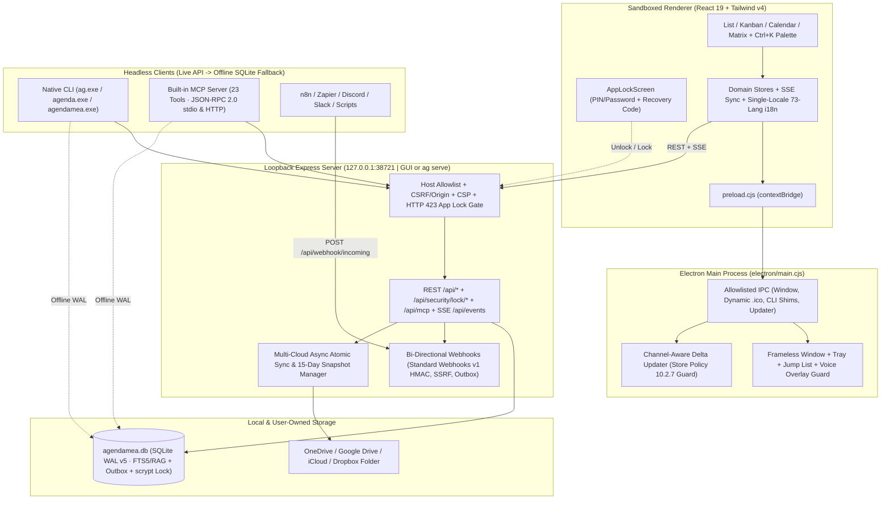

<div align="center">

<a href="https://vellium.dev" target="_blank" rel="noopener noreferrer">
  
</a>

<br /><br />

#  Agendamea - Free &amp; Open-Source Local-First Task Manager, Local AI &amp; Automation for Windows

</div>

---

<div align="center">

[](#english-version)
&nbsp;&nbsp;&nbsp;&nbsp;
[](#turkish-version)

</div>

---

<div align="center">

[](https://github.com/emirtdede/agendamea/actions/workflows/ci.yml)


</div>

---

<a id="english-version"></a>

# English Version

<div align="center">
  <picture>
    <source media="(prefers-color-scheme: dark)" srcset="public/logos/agendamea-mark-dark.svg" />
    
  </picture>
  <h3>Agendamea - Free, Open-Source Local-First Daily Task Manager, On-Device AI &amp; Automation Suite for Windows</h3>
  <p><em>4-Way Planning Views + Spotlight Command Palette (Ctrl+K) + Optional PIN/Password App Lock + On-Device Local AI &amp; Neural Voice Dictation + 23-Tool Built-in MCP Server + Native CLI (ag) + Multi-Cloud Sync + 73 Languages</em></p>
  <p><strong>Free &amp; Open-Source (MIT) by <a href="https://vellium.dev">Vellium</a></strong></p>
</div>

<br>

##  Project Overview

**Agendamea (`v1.1.0`)** is a **free, open-source (`MIT`), local-first Windows daily task manager, on-device AI voice assistant, and automation suite** engineered by **Vellium** for everyday desktop users (zero terminal required) as well as power users and AI coding agents. Built with **Electron 45**, **React 19**, **TypeScript 7**, **Express 4**, **WAL-mode SQLite (`better-sqlite3`, schema v5 with FTS5 + Hybrid RAG)**, and native **.NET 10** Windows tooling, every task, schedule, `#tag`, subtask, auto-saving note, category, shortcut, notification profile, and security preference saves instantaneously to your device with zero accounts, subscriptions, or external telemetry.

Beyond four interactive workspace views (**List**, **Kanban**, **Calendar**, **Eisenhower Matrix**), Agendamea includes a **Spotlight Command Palette (`Ctrl+K`)**, **optional 4/6/8-digit PIN or Password App Lock** (with one-time Recovery Code, idle/minimize locking, HTTP `423` API protection, and dictation lock guard), a **Notification Center with Focus Mode**, **universal right-click context menus**, **100% customizable shortcuts**, and **Zero-Cost Multi-Cloud Folder Sync** across **OneDrive**, **Google Drive**, **iCloud Drive**, **Dropbox**, or any local/network folder with 15-day rolling daily snapshots.

For local AI and automation, Agendamea provides **One-Click Local AI Setup** with hardware auto-profiling (**5 GPU + 2 CPU profiles + Ollama / LM Studio**), **100% offline neural voice dictation & TTS** (**RNNoise WASM**, **Silero VAD v5**, **Whisper.cpp**, **Qwen3**, **Piper VITS ONNX**), a **native C# terminal CLI** (`ag.exe`, `agenda.exe`, `agendamea.exe`), a **built-in 23-tool Model Context Protocol (MCP) server** (`ag mcp` and in-process Streamable HTTP `/api/mcp`) with a **12-client 1-click installer hub**, a **headless local API & webhook daemon** (`ag serve`), and **bi-directional Standard Webhooks v1 HMAC-SHA256 automation**.

> **Documentation:** architecture, keyboard shortcuts, 73-language localization, release process, and Microsoft Store packaging checklists are indexed in [`docs/README.md`](docs/README.md).

---

##  Key Features

###  4-Way Workspace Views, Command Palette (`Ctrl+K`) &amp; Daily Planning

- **Flat List View:** Smart views (`All`, `Today`, `Important`, `Completed`), custom categories with 8 curated colors + 2D HSV custom spectrum picker, pinning, virtualized rendering (`VirtualizedTodoList`), instant search across titles/notes/subtasks/`#tags` with automatic **Date Range filtering**, and drag-and-drop or `Alt+Up/Down` keyboard ordering.
- **Kanban Board:** Group tasks dynamically by **Priority** (`High`, `Normal`, `Low`) or **Status** (`Active`, `Completed`) with drag-and-drop transitions and optional drag lock protection.
- **Calendar Planner:** Monthly calendar grid with chronological `HH:mm` time sorting per day, multi-day date spans, and a collapsible **Undated Tasks** drawer supporting drag-to-schedule directly onto dates.
- **Eisenhower Matrix:** Automatic 4-quadrant classification (`Q1 Urgent & Important`, `Q2 Important`, `Q3 Urgent`, `Q4 Later`) with drag-and-drop reprioritization across quadrants.
- **Spotlight Command Palette (`Ctrl+K`) &amp; Context Menus:** Jump across tasks, categories, views, settings tabs, quick creation, and instant App Lock from anywhere; right-click any task row, board card, calendar cell, sidebar category, subtask, or trash item for viewport-clamped actions.
- **Notification Center &amp; Focus Mode:** Dedicated **Settings -> Notifications** tab with one-click preset profiles (**Balanced**, **All Enabled**, **Focus Mode**, **In-App Only**, **Custom**), configurable lead time (`5-60 min`), and 4-way per-event controls (**Both**, **In-App**, **Desktop**, **Off**) across 6 event categories.

###  On-Device Local AI, One-Click Setup, Hybrid RAG &amp; Neural Voice Dictation

- **One-Click Local AI Setup &amp; Hardware Profiling:** Automatically detects 64-bit GPU VRAM, system RAM, CPU cores, and free disk space, recommending optimal **5 GPU + 2 CPU** local profiles (100% Apache 2.0 / MIT: **Whisper.cpp**, **Qwen3**, **Multilingual-E5**) plus zero-download **Ollama / LM Studio** external local engine integration and a built-in **Live AI Test Playground**.
- **100% Offline Neural Voice Pipeline:** **Mozilla RNNoise WASM** (`48 kHz` AudioWorklet) noise suppression, **Silero VAD v5 ONNX** neural voice activity detection with adaptive EMA noise floor, selectable microphone + live audio level meter, 5 ready chimes, and a compact taskbar voice overlay pill triggered globally via **`Ctrl+Alt+D`** (with OS conflict detection and automatic fallback).
- **Local Neural TTS (`Piper VITS ONNX`):** 5 SHA-256 verified voices (Turkish Female/Male: Ilkiz, Fahrettin, Fettah; English Female/Male: Kristin, Joe), 5 speaking style presets (`Natural`, `Crisp`, `Calm`, `Bright`, `Studio`), seamless Windows OneCore fallback, and zero external CDN requests.
- **Hybrid FTS5 + Vector RAG:** Local chunked task/note retrieval powering natural-language queries across the voice overlay, `ag rag`, `ag ask`, and MCP (`agendamea_semantic_search`, `agendamea_ask`).

###  Built-in 23-Tool MCP Server (12-Client Hub), Native CLI (`ag.exe`) &amp; Headless Daemon

- **23-Tool Built-in MCP Server (`mcp/server.cjs` / `ag mcp` / `POST /api/mcp`):** MCP `2025-11-25` JSON-RPC 2.0 server with **23 tools**, **5 static resources**, **2 resource templates**, and **4 guided prompts**. Works with zero global Node.js via bundled `Agendamea.exe` in both **Live API** (in-process HTTP) and **Cold-Start Offline SQLite** modes.
- **12-Client One-Click MCP Hub:** Collapsible `6x2` integration hub inside Settings supporting **Claude Desktop**, **Cursor**, **VS Code**, **Windsurf**, **Claude Code**, **Antigravity**, **ChatGPT Codex** (comment-preserving TOML), **OpenCode**, **Bionic (LM Studio)**, **Zed**, **Gemini CLI**, and **Custom MCP** (`.json` / `.jsonc` / `.toml`) with automatic `.bak` backups and live handshake testing.
- **Native Windows C# Terminal CLI (`ag.exe` / `agenda.exe` / `agendamea.exe`):** 1-click PATH installation, quote-free natural tokens (`@today`, `@tomorrow`, `@start..due`, `14:30`, `!`, `*`, `^`, `#tag`, `/Category`, `--note`, `--sub`), batch operations (`ag ok 1 2 3`, `ag rm 1 2`), stdin piping, terminal views (`ag cal`, `ag kanban`, `ag matrix`), local AI/RAG (`ag ai`, `ag rag`, `ag ask`), and `--json` output.
- **Headless Background Daemon &amp; Bi-Directional Webhooks (`ag serve`):** Run the loopback `127.0.0.1` API, SSE stream, and incoming webhook listener without opening the GUI; outgoing Discord/Slack/JSON webhooks feature Standard Webhooks v1 HMAC-SHA256 signing, SSRF DNS checks, persistent retry/dead-letter `webhook_outbox`, delivery audit logs (`webhook_logs`), and constant-time verified `POST /api/webhook/incoming`.

###  Self-Healing SQLite v5 Engine, Searchable Trash &amp; Clean Start

- **WAL-Mode SQLite (`better-sqlite3`, `user_version = 5`):** Runs with `journal_mode = WAL`, `synchronous = NORMAL`, `foreign_keys = ON`, `busy_timeout = 5000`, FTS5 + Hybrid RAG chunk tables, webhook outbox/logs, and reminder deduplication.
- **Corruption Self-Healing:** If a local database is damaged by power loss, Agendamea quarantines the broken file to `.corrupt-<timestamp>.bak` and initializes a clean database automatically without wiping unrelated files.
- **Searchable Trash &amp; 12-Second Undo:** Instant search, type filters, sorting, deletion date-range filters, configurable retention, and a **12-second hover-pausing Undo toast**.
- **Atomic Backup, Restore &amp; Clean Start:** One-click JSON export (`/api/export`), 5 MB validated transactional import (`/api/import`), and a 2-step **Reset All Data** action with optional settings reset (`/api/reset`).

###  Zero-Cost Multi-Cloud Folder Sync

- **Automatic Multi-Provider Detection:** Auto-detects **OneDrive**, **Google Drive** (including virtual drive letters `D:`-`Z:` and localized names), **iCloud Drive**, and **Dropbox** (`info.json`), or connects to any custom local/network folder.
- **Crash-Safe Atomic Writes &amp; 15-Day Rolling History:** Non-blocking async `.tmp` rename swaps, `agendamea-onedrive-previous.json` fallback, **15 rolling daily snapshots**, and automatic recovery from interrupted writes.
- **Reinstall Recovery Banner &amp; Headless Pull:** Detects existing cloud backups on fresh installs to prompt **Restore Backup** vs **Start Fresh**, plus headless `ag sync auto|set|pull|status` commands.

###  28+ Theme Palettes, Custom HEX, Dynamic Icons, 11-Tab Settings &amp; 73 Languages

- **14 Dual-Mode Themes + Custom HEX Generator:** `Obsidian`, `Slate`, `Navy`, `Blue`, `Cyan`, `Indigo`, `Purple`, `Pink`, `Red`, `Orange`, `Yellow`, `Emerald`, `Grass`, `Lime`, plus unlimited **Custom HEX (`#RRGGBB`)** palettes with copyable HEX badges, WCAG AA contrast tokens, self-hosted local WOFF2 fonts, and anti-FOUC caching.
- **Dynamic System-Wide App Icons:** Match theme automatically or pick Monochrome Dark/Light, any palette color, or a **Custom HEX icon** - synchronized live across the window, taskbar, tray, Jump List, and Desktop / Start Menu shortcuts (`.lnk`).
- **11-Tab Settings Hub &amp; 10-Step Welcome Guide:** Organized across 3 groups (_Personalization_, _Workspace_, _System_) with **73-language deep Settings search**, collapsible 73-language selector, accessibility suite (`80%-150%` zoom, High Contrast, Reduced Motion), interactive shortcut recorder, and a 10-step onboarding guide.
- **73 Languages with Single-Locale Fast Boot:** All 73 languages verified at 1,112 UI keys each with zero leakage, full **RTL** mirroring (`ar`, `fa`, `he`, `ur`), single-locale startup (loads only the active language chunk at boot with clean **Language Restart Modal** switching), and 5 offline localized legal documents.

###  Optional App PIN / Password Lock, Loopback Isolation &amp; Auto-Updates

- **Optional App PIN / Password Lock:** Protect local tasks with a **4, 6, or 8-digit numeric PIN** or a **custom Password** (6-128 chars), salted `crypto.scrypt` hashing (`N=16384`), exponential brute-force backoff lockout, a one-time **Recovery Code** (`XXXX-XXXX-XXXX-XXXX`), configurable auto-lock idle timeout (`1-60 min` or `Never`), lock-on-minimize/hide, instant manual lock (`Sidebar` / `Ctrl+K`), zero-flash cold-start boot lock, HTTP **`423 Locked`** server gate, SSE pause while locked, and **Voice Dictation Lock Guard** (automatically cancels active mic/TTS on lock and blocks dictation overlay while locked).
- **Hardened Loopback &amp; Electron 45 Sandbox:** Renderer runs with `contextIsolation: true`, `nodeIntegration: false`, `sandbox: true`, strict `'self'` CSP with self-hosted fonts, and an explicit external domain allowlist (`vellium.dev`, `github.com`). Express binds strictly to `127.0.0.1` with DNS-rebinding Host checks, `Sec-Fetch-Site` / `Origin` CSRF guards, and UTF-8/Windows-1254 safe JSON decoding.
- **Channel-Aware Auto-Updates:** SHA-512 verified `electron-updater` delta updates on GitHub builds, strictly disabled in Microsoft Store MSIX builds (`process.windowsStore === true`) per Store Policy 10.2.2 / 10.2.7.

---

##  Tech Stack

<div align="center">


</div>

### Desktop, Packaging &amp; Local Backend

- **Electron 45.4, .NET 10 WPF &amp; NativeAOT (`electron-builder 26.18`)** - Frameless Windows shell, taskbar voice overlay, tray, Jump List, dynamic `.ico` generator, modern `640x420` monochrome WPF Setup &amp; Uninstaller (`Agendamea.Setup`), NativeAOT + parallel Brotli `AGM_SFX2` single-file Portable (`Agendamea.Portable`), native C# CLI shim (`Agendamea.Cli`), and Microsoft Store `.appx`/MSIX packaging.
- **Express 4.21 &amp; Node.js 22+** - Loopback REST API (`127.0.0.1`), HTTP `423` App Lock security gate, UTF-8/Windows-1254 safe JSON decoder, singleton SSE stream (`/api/events`), Standard Webhooks v1 engine, multi-cloud async sync, and on-demand `application/wasm` asset streaming.
- **better-sqlite3 13.2** - Synchronous SQLite WAL v5 engine (`user_version = 5`) with FTS5 + Hybrid RAG index, `webhook_outbox`, `webhook_logs`, and `.corrupt-*.bak` self-healing.

### Local AI, Neural Audio, CLI &amp; MCP

- **100% Offline Neural Voice &amp; AI** - Mozilla RNNoise WASM (`48 kHz`), Silero VAD v5 ONNX, Piper VITS ONNX Neural TTS (5 verified voices + 5 styles + 5 chimes), Whisper.cpp + Qwen3 + Multilingual-E5 (`sharedLlama`), plus Ollama / LM Studio integration.
- **`shared/` Domain Layer** - Canonical CJS modules (`sqliteCore`, `todoRepository`, `settingsCodec`, `appLockCrypto`, `localStore`, `webhookEngine`, `aiCatalog`, `piperVoices`) shared across Server, CLI, and MCP with zero schema drift.
- **`cli/agendamea.cjs` &amp; `installer/Agendamea.Cli`** - Native 64-bit `ag.exe` / `agenda.exe` / `agendamea.exe` shims with High-Entropy ASLR/DEP and zero PowerShell window flicker.
- **`mcp/server.cjs` (`ag mcp` &amp; `/api/mcp`)** - MCP `2025-11-25` JSON-RPC 2.0 server exposing 23 tools, 5 static resources, 2 resource templates, and 4 prompts.

### Frontend, Testing &amp; Release Quality Gates

- **React 19, TypeScript 7, Tailwind CSS v4 &amp; Vite 8** - Isolated `useSyncExternalStore` domain stores (`src/store/`), `VirtualizedTodoList`, lazy-loaded modals/overlays, single-locale boot, self-hosted WOFF2 fonts, and strict bundle budget enforcement.
- **Automated Verification Suites** - **118 Node unit/integration/security/i18n tests** (`npm test`), **51 Vitest + React Testing Library UI tests** (`npm run test:ui`), **19 .NET 10 WPF Setup &amp; SFX2 tests** (`npm run test:setup`), **real Electron Playwright E2E smoke tests** (`npm run test:e2e`), Biome lint/format (`npm run check:biome`), strict `tsc` + `checkJs`, license compliance, and GitHub Actions CI/Release workflows.

---

##  Project Structure

```tree
Agendamea/
├── .github/workflows/
│   ├── ci.yml                       # Automated Biome, tsc, licenses, 118 Node + 51 UI + 19 .NET tests, budgets & E2E
│   └── release.yml                  # Tagged Windows x64 Modern Setup, NativeAOT Portable, Store .appx & SHA256SUMS
├── assets/
│   ├── vellium-banner.svg           # Monochrome Vellium header banner
│   └── icons/                       # Monochrome 20x20 documentation SVG icons
├── cli/
│   ├── agendamea.cjs                # Short quote-free CLI entrypoint (ag / agenda / agendamea)
│   ├── commands/                    # Modular system, AI/RAG & webhook/cloud CLI subcommands
│   └── lib/                         # Shared CLI formatting, snapshots & shell helpers
├── mcp/
│   └── server.cjs                   # MCP 2025-11-25 JSON-RPC 2.0 server (23 tools, 5 resources, 2 templates, 4 prompts)
├── shared/
│   ├── sqliteCore.cjs               # Canonical SQLite WAL v5 schema & migrations
│   ├── todoRepository.cjs           # Shared CRUD, trash & atomic reset repository
│   ├── settingsCodec.cjs            # Zero-drift 45+ key settings codec (incl. App Lock) shared by server & CLI
│   ├── appLockCrypto.cjs            # Salted scrypt PIN/Password hashing, recovery code & lockout crypto
│   ├── localStore.cjs               # Unified Live API + Cold-Start Offline WAL SQLite engine
│   ├── webhookEngine.cjs            # Standard Webhooks v1 HMAC signing, SSRF guard & retry backoff
│   ├── aiCatalog.cjs                # Verified Apache 2.0 / MIT local AI catalog (5 GPU + 2 CPU + Ollama/LM Studio)
│   ├── piperVoices.cjs              # Verified MIT / CC0 Piper VITS ONNX Neural TTS catalog & downloader
│   ├── cliLocales/ & serverLocales/ # 73-language CLI & backend localization bundles
│   └── cliInstaller.cjs             # Shared Windows PATH shim installer (ag.exe / ag.target.json)
├── installer/
│   ├── Agendamea.Cli/               # Native 64-bit Windows CUI console shim source (ag.exe, /highentropyva+)
│   ├── Agendamea.Portable/          # NativeAOT .NET 10 single-file Brotli AGM_SFX2 portable cache launcher
│   ├── Agendamea.Setup/             # Native .NET 10 WPF 640x420 monochrome frameless Setup & Uninstaller
│   └── Agendamea.Setup.Tests/       # 19 automated .NET Setup, SFX2, Zip-Slip & 73-locale parity tests
├── docs/                            # Indexed architecture, shortcuts, 73-language i18n, release & Store docs
├── electron/
│   ├── main.cjs                     # Electron main window, tray, Jump List, StartupTask & single-instance shell
│   ├── modules/                     # Modular backend lifecycle, allowlisted IPC, shortcuts & delta auto-updater
│   ├── ai/                          # Shared Llama runtime, Whisper STT, Qwen3/Ollama LLM, embeddings & orchestrator
│   ├── voiceOverlay.cjs             # Taskbar voice dictation overlay with App Lock cancel/activity guard
│   ├── preload.cjs                  # Context-isolated renderer IPC bridge
│   └── iconGenerator.cjs            # Pure-Node multi-resolution Windows .ico & .lnk updater
├── electron-resources/              # Windows icons, MSIX StartupTask extensions & 76 Store APPX tiles
├── public/                          # Self-hosted WOFF2 fonts, PWA manifest icons, Windows tiles & audio worklets
├── scripts/                         # Clean, CLI shim, esbuild server, SFX2 packer, Portable & WPF Setup builders
├── server/
│   ├── middleware/                  # Loopback host, CSRF, headers, App Lock 423 guard & sync folder security
│   ├── routes/                      # Modular core CRUD, security/app-lock, webhooks, in-process MCP, cloud & AI routes
│   └── services/                    # App Lock service, non-blocking cloud sync, webhook worker, AI runtime & MCP store
├── src/
│   ├── api/                         # Typed REST client, AppLockRequiredError & singleton SSE eventStream bus
│   ├── components/                  # Virtualized list, 4 views, CommandPalette, AppLockScreen, WelcomeModal & 11 Settings tabs
│   ├── store/                       # Zero-dep React 19 useSyncExternalStore isolated domain stores (incl. appLockStore)
│   ├── db/database.ts               # TodoDatabase (SQLite WAL v5, FTS5/RAG, transactional imports)
│   ├── hooks/                       # Notifications, updater, hotkeys, SSE sync, context menus & drag-and-drop
│   ├── i18n/                        # 73-language single-locale loader (1,112 keys x 73 locales, zero leakage)
│   ├── overlay/                     # Standalone taskbar voice dictation overlay entry
│   ├── utils/                       # Pure domain logic, themes, shortcuts, notifications & Intl cache
│   ├── voice/                       # RNNoise WASM, Silero VAD v5, Piper ONNX TTS & AudioWorklet capture
│   ├── App.tsx                      # Root workspace orchestration, App Lock gate & SSE live sync
│   └── types.ts                     # Shared TypeScript domain models
├── tests/                           # 118 Node unit/integration/security tests, 51 Vitest UI tests & Electron E2E smoke
├── winget/manifests/                # WinGet 1.6.0 manifests (Vellium.Agendamea 1.1.0)
├── server.ts                        # Modular Express loopback server & zero-flash lock boot injector
├── electron-builder.yml             # Windows unpacked & Microsoft Store APPX/MSIX packaging config
├── CHANGELOG.md                     # Version history
├── LICENSE                          # MIT License (Vellium Teknoloji Anonim Sirketi)
└── package.json                     # Scripts, bin (agendamea) & v1.1.0 metadata
```

---

##  Architecture &amp; Security Boundaries



**Security model.** The renderer never receives Node.js access (`contextIsolation: true`, `nodeIntegration: false`, `sandbox: true`), loads strictly self-hosted fonts under `'self'` CSP, and restricts external links to an explicit allowlist (`vellium.dev`, `github.com`). The embedded Express API listens exclusively on loopback (`127.0.0.1`), enforces Host DNS-rebinding checks and `Sec-Fetch-Site` / `Origin` CSRF guards, blocks all data endpoints with HTTP `423 Locked` while optional App Lock (`scrypt` salted hash + exponential backoff) is active, immediately cancels voice dictation when locked, validates incoming webhooks with constant-time HMAC-SHA256 (`crypto.timingSafeEqual`), blocks SSRF private/metadata targets, caps imports at `5 MB`, and performs all writes atomically with zero telemetry.

---

##  Storage &amp; Security Schema

| Path / Boundary                         | Protection                                                    | Contents                                                                                                           |
| :-------------------------------------- | :------------------------------------------------------------ | :----------------------------------------------------------------------------------------------------------------- |
| `%APPDATA%\Agendamea\agendamea.db`      | SQLite WAL v5, `foreign_keys = ON`, `.corrupt-*.bak` recovery | `categories`, `todos`, `subtasks`, `rag_chunks`, `webhook_logs`, `webhook_outbox`, `settings` (`user_version = 5`) |
| `settings` (App Lock keys)              | Salted `crypto.scrypt` (`N=16384`), one-time recovery hash    | Optional PIN/Password lock config, failed-attempt backoff state, idle timeout &amp; minimize-lock preferences      |
| `%APPDATA%\Agendamea\runtime-port.json` | Loopback port discovery &amp; headless PID metadata           | Active `127.0.0.1` API port for live CLI/MCP routing                                                               |
| `%APPDATA%\Agendamea\dynamic-icons\`    | Generated multi-resolution `.ico` &amp; tray `.png`           | Active system-wide custom/themed Agendamea icons                                                                   |
| `%LOCALAPPDATA%\Agendamea\bin\`         | User-scoped PATH shims (64-bit `/highentropyva+`, no UAC)     | Native C# `ag.exe`, `agenda.exe`, `agendamea.exe`, and `ag.target.json`                                            |
| `<CloudFolder>\Agendamea\`              | Async atomic `.tmp` swap, 15-day snapshots, corrupt fallback  | `agendamea-onedrive-sync.json`, previous &amp; daily snapshots                                                     |
| Loopback API (`127.0.0.1`)              | Host allowlist, CSRF guard, HTTP `423` lock, HMAC-SHA256, CSP | Local REST CRUD, `/api/security/lock/*`, `/api/mcp`, `/api/events` SSE, `/api/webhook/incoming`, cloud sync        |

---

##  CLI &amp; Built-in MCP Server Usage

### Native Terminal &amp; PowerShell CLI (`ag` / `agenda` / `agendamea`)

Install once via **Settings -> Automation &amp; CLI / MCP -> Install CLI (`ag`)** or headlessly via `node cli/agendamea.cjs install`:

```powershell
# List active tasks numbered 1, 2, 3 (works with GUI open OR closed)
ag

# Add a task naturally without quotes (date range, time, priority, important, pin, tags, category, subtasks)
ag + Prepare launch deck @2026-11-28..2026-11-30 14:30 ! * ^ #release /Work --sub "Verify packages"

# Inspect full task details, complete multiple tasks in one command, or restore from Trash
ag show 1
ag ok 1 2 3
ag undo

# Terminal planning views (Calendar agenda, Kanban board, Eisenhower Matrix)
ag cal
ag kanban
ag matrix

# On-device Local AI & Hybrid RAG search directly from terminal
ag ai status
ag rag "quarterly budget"
ag ask "What are my top priorities for today?"

# Headless local API & incoming webhook daemon (receive n8n/Zapier/curl webhooks without opening GUI)
ag serve start
ag hook set https://discord.com/api/webhooks/... my-hmac-secret
ag hook logs

# Auto-connect cloud folder, export/import backups (supports stdin pipe), or check updates
ag sync auto
ag export backup.json
ag update
```

### Model Context Protocol (MCP) Server (`ag mcp` - 23 Built-in Tools)

Configure in one click from **Settings -> Automation &amp; CLI / MCP** (12 clients supported), or add manually (no global Node.js required):

```json
{
  "mcpServers": {
    "agendamea": {
      "command": "ag",
      "args": ["mcp"]
    }
  }
}
```

<details>
<summary>View all 23 built-in MCP tools, 5 static resources, 2 resource templates &amp; 4 prompts</summary>

- **23 Tools:** `agendamea_status` · `agendamea_list_tasks` · `agendamea_get_task` · `agendamea_add_task` · `agendamea_update_task` · `agendamea_complete_task` · `agendamea_pin_task` · `agendamea_delete_task` · `agendamea_clear_completed` · `agendamea_manage_subtask` · `agendamea_list_categories` · `agendamea_manage_category` · `agendamea_list_trash` · `agendamea_manage_trash` · `agendamea_eisenhower_matrix` · `agendamea_get_settings` · `agendamea_update_settings` · `agendamea_backup_and_sync` · `agendamea_views` · `agendamea_webhook_and_server` · `agendamea_semantic_search` · `agendamea_ai_status` · `agendamea_ask`
- **5 Static Resources:** `agendamea://status` · `agendamea://tasks/today` · `agendamea://tasks/overdue` · `agendamea://matrix` · `agendamea://categories`
- **2 Resource Templates:** `agendamea://task/{id}` · `agendamea://category/{name}/tasks`
- **4 Prompts:** `daily_plan` · `triage_overdue` · `eisenhower_review` · `weekly_summary`

</details>

---

##  Installation &amp; Usage

### Installing as an End User (Windows)

1. Download **`Agendamea-Setup-1.1.0-win-x64.exe`** (recommended) or zero-install **`Agendamea-Portable-1.1.0-win-x64.exe`** from [GitHub Releases](https://github.com/emirtdede/agendamea/releases).
2. Run the modern frameless monochrome setup. **No administrator (UAC) elevation is required** - it installs per-user into `%LOCALAPPDATA%\Programs\Agendamea`.
3. Open **Options** to switch live across all **73 languages** (with RTL support), pick your install directory, or toggle Desktop/Start Menu shortcuts, Windows startup, and `ag` CLI PATH shims (supports silent `/S`, `/P`, `/DIR="..."`, `--uninstall`, `--delete-data`).
4. Launch **Agendamea** from the Start Menu or Desktop shortcut (or run `ag` from any terminal).

**SmartScreen on unsigned direct downloads:** For direct GitHub downloads, Windows SmartScreen may show "Windows protected your PC" on first run. Select **More info -> Run anyway**.

**Uninstall:** Windows Settings -> Apps -> Agendamea -> Uninstall. Local user data under `%APPDATA%\Agendamea` is preserved by default with an interactive option to keep or permanently remove data in the custom uninstaller.

### Prerequisites (Building from Source)

- **Windows 10 (1809+) or Windows 11** (64-bit)
- **Node.js 22+**, **npm**, and **.NET 10 SDK** (for WPF Setup, NativeAOT Portable &amp; `ag.exe` CLI shim)
- **Git**

### Run &amp; Build from Source

```bash
git clone https://github.com/emirtdede/agendamea.git
cd agendamea
npm install

# Run Web + API dev server or Electron desktop app
npm run dev
npm run electron:dev

# Full verification & quality gates
npm run check:biome     # Biome lint & format check
npm run lint            # Strict TypeScript + CJS checkJs type-check
npm run check:licenses  # Production dependency license audit
npm test                # 118 Node unit, AI, security, App Lock, 73-language, CLI, MCP & webhook tests
npm run test:ui         # 51 Vitest + React Testing Library UI component tests
npm run test:setup      # 19 .NET 10 WPF modern setup, SFX2, Zip-Slip & 73-locale tests
npm run build           # Sync offline voice assets + ag.exe shim + Vite bundle + esbuild server
npm run check:budget    # Production JS/CSS bundle size budget verification
npm run test:e2e        # Real Electron BrowserWindow Playwright E2E smoke test

# Build Windows x64 Modern WPF Setup, NativeAOT Portable & Microsoft Store APPX (release/)
npm run dist:win
npm run dist:win:appx
```

---

##  Distribution Packages

Build artifacts are produced under `release/`:

- **Modern Frameless Setup Installer** - `Agendamea-Setup-1.1.0-win-x64.exe` (single-file monochrome `640x420` WPF setup + bundled `uninstall.exe`, Brotli `AGM_SFX2` payload, silent `/S` support)
- **Fast NativeAOT Portable Executable** - `Agendamea-Portable-1.1.0-win-x64.exe` (NativeAOT cache launcher + parallel Brotli `AGM_SFX2` payload)
- **Microsoft Store Package** - `Agendamea-Store-1.1.0-win-x64.appx` (`Vellium.Agendamea`, MSIX `windows.startupTask` + Store Policy 10.2.7 compliant)
- **Checksums &amp; WinGet** - `SHA256SUMS.txt`, `latest.yml`, and `winget/manifests/v/Vellium/Agendamea/1.1.0/`

Published builds and release notes are available on the [GitHub Releases](https://github.com/emirtdede/agendamea/releases) page.

---

##  License &amp; Publisher

**Free &amp; Open-Source Software (`MIT`).** Copyright © 2026 **Vellium Teknoloji Anonim Şirketi**.

Licensed under the MIT License. You may use, inspect, modify, and distribute Agendamea freely for personal, community, or commercial environments. See [`LICENSE`](LICENSE) for full terms.

- **Publisher:** Vellium Teknoloji Anonim Şirketi ([Company Information](https://vellium.dev/en/legal/company-information))
- **Official Website &amp; Repository:** [vellium.dev](https://vellium.dev) &bull; [GitHub Repository](https://github.com/emirtdede/agendamea)
- **Legal Hub:** [Privacy Policy](https://vellium.dev/en/legal/privacy) &bull; [Terms of Service](https://vellium.dev/en/legal/terms) &bull; [Support Policy](https://vellium.dev/en/legal/support) &bull; [Security Disclosure](https://vellium.dev/en/legal/security-disclosure) &bull; [KVKK Notice](https://vellium.dev/en/legal/kvkk-notice)
- **Official Emails:** General [contact@vellium.dev](mailto:contact@vellium.dev) &bull; Support [support@vellium.dev](mailto:support@vellium.dev) &bull; Privacy [privacy@vellium.dev](mailto:privacy@vellium.dev) &bull; Legal [legal@vellium.dev](mailto:legal@vellium.dev) &bull; Security [security@vellium.dev](mailto:security@vellium.dev)
- **Official Social &amp; Community Channels:** [GitHub @VelliumHQ](https://github.com/VelliumHQ) &bull; [LinkedIn](https://www.linkedin.com/company/vellium/) &bull; [X @VelliumDev](https://x.com/VelliumDev) &bull; [Product Hunt @vellium](https://www.producthunt.com/@vellium) &bull; [Instagram @velliumdev](https://www.instagram.com/velliumdev/) &bull; [Threads @velliumdev](https://www.threads.com/@velliumdev) &bull; [Reddit u/VelliumDev](https://www.reddit.com/user/VelliumDev/) &bull; [Discord](https://discord.gg/ur9KBZBEdj)

---

<br>

---

<a id="turkish-version"></a>

# Türkçe Versiyon

<div align="center">
  <picture>
    <source media="(prefers-color-scheme: dark)" srcset="public/logos/agendamea-mark-dark.svg" />
    
  </picture>
  <h3>Agendamea - Windows İçin Ücretsiz ve Açık Kaynak, Yerel Öncelikli Görev Yöneticisi, Yerel AI ve Otomasyon Paketi</h3>
  <p><em>4 Farklı Planlama Görünümü + Komut Paleti (Ctrl+K) + Opsiyonel PIN/Şifre Kilidi + Cihaz İçi Yerel Yapay Zeka ve Sesli Dikte + 23 Araçlı MCP Sunucusu + Yerel CLI (ag) + Çoklu Bulut Eşitleme + 73 Dil</em></p>
  <p><strong>Ücretsiz ve Açık Kaynak (MIT) - <a href="https://vellium.dev">Vellium</a> tarafından geliştirildi</strong></p>
</div>

<br>

##  Proje Genel Bakışı

**Agendamea (`v1.1.0`)**, **Vellium** tarafından hem günlük masaüstü kullanıcıları (terminal gerekmeden) hem de ileri düzey kullanıcılar ve yapay zeka kodlama ajanları için geliştirilmiş; **ücretsiz, açık kaynak (`MIT`) ve yerel öncelikli (local-first)** bir Windows görev yöneticisi, cihaz içi sesli asistan ve otomasyon paketidir. **Electron 45**, **React 19**, **TypeScript 7**, **Express 4**, **WAL modlu SQLite (`better-sqlite3`, FTS5 + Hibrit RAG v5 şeması)** ve yerel **.NET 10** Windows araçlarıyla inşa edilmiştir. Görevler, tarih aralıkları, saatler, `#etiketler`, alt görevler, otomatik kaydedilen notlar, kategoriler, kısayollar, bildirim profilleri ve güvenlik tercihleri; hesap, abonelik veya harici telemetri olmadan anında cihazınıza kaydedilir.

Dört farklı çalışma görünümünün (**Liste**, **Kanban**, **Takvim**, **Eisenhower Matrisi**) yanı sıra **Spotlight Komut Paleti (`Ctrl+K`)**, **opsiyonel 4/6/8 haneli PIN veya Şifre Kilidi** (tek kullanımlık Kurtarma Kodu, boşta/simge durumunda otomatik kilit, HTTP `423` API koruması ve dikte kilit koruması), **Odak Modu destekli Bildirim Merkezi**, **evrensel sağ tık bağlam menüleri**, **tamamen özelleştirilebilir kısayollar** ve **OneDrive**, **Google Drive**, **iCloud Drive**, **Dropbox** veya dilediğiniz klasörle **15 günlük döngüsel ücretsiz bulut eşitleme** sunar.

Yapay zeka ve otomasyon tarafında donanımı otomatik algılayan **Tek Tıkla Yerel AI Kurulumu** (**5 GPU + 2 CPU profili + Ollama / LM Studio**), **%100 çevrimdışı sinirsel sesli dikte ve seslendirme** (**RNNoise WASM**, **Silero VAD v5**, **Whisper.cpp**, **Qwen3**, **Piper VITS ONNX**), yerel C# **terminal CLI** (`ag.exe`, `agenda.exe`, `agendamea.exe`), **12 istemcili tek tık kurulum merkezli 23 araçlı MCP sunucusu** (`ag mcp` ve süreç içi `/api/mcp`), arka plan **arayüzsüz API ve Webhook servisi** (`ag serve`) ve **Standard Webhooks v1 HMAC-SHA256 çift yönlü otomasyon** ile gelir.

> **Dokümantasyon:** mimari, klavye kısayolları, 73 dil desteği, sürüm süreci ve Microsoft Store kontrol listesi [`docs/README.md`](docs/README.md) içinde indekslenmiştir.

---

##  Öne Çıkan Özellikler

###  4 Farklı Çalışma Görünümü, Komut Paleti (`Ctrl+K`) ve Günlük Planlama

- **Düz Liste Görünümü:** Akıllı görünümler (`Tümü`, `Bugün`, `Önemli`, `Tamamlananlar`), 8 hazır renk + 2B HSV özel renk seçicili kategoriler, sabitleme, sanallaştırılmış liste (`VirtualizedTodoList`), başlık/not/alt görev/`#etiket` aramasıyla birlikte otomatik **Tarih Aralığı filtresi** ve sürükle-bırak veya `Alt+Yukarı/Aşağı` sıralama.
- **Kanban Panosu:** Görevleri **Önceliğe** veya **Duruma** göre sütunlarda yönetme, sürükle-bırak geçişleri ve sürükleme kilidi.
- **Takvim Planlayıcı:** Gün içi `SS:dd` kronolojik sıralamalı aylık takvim ızgarası, çok günlü görev şeritleri ve sürükle-bırak tarihlendirme destekli **Tarihsiz Görevler** çekmecesi.
- **Eisenhower Matrisi:** 4 kadranlı (`I Acil ve Önemli`, `II Önemli`, `III Acil`, `IV Sonra`) otomatik sınıflandırma ve sürükle-bırak önceliklendirme.
- **Komut Paleti (`Ctrl+K`) ve Bağlam Menüleri:** Görevler, kategoriler, görünümler, ayar sekmeleri, hızlı görev ekleme ve anında kilitleme arasında klavyeyle geçiş; tüm liste satırları, kartlar, takvim hücreleri ve çöp kutusu öğelerinde sağ tık bağlam menüleri.
- **Bildirim Merkezi ve Odak Modu:** Tek tıkla hazır profiller (**Dengeli**, **Tümü Açık**, **Odak Modu**, **Yalnızca Uygulama İçi**, **Özel**), ayarlanabilir hatırlatma süresi (`5-60 dk`) ve 6 olay kategorisinde 4 yönlü kanal seçimi (**İkisi de**, **Uygulama İçi**, **Masaüstü**, **Kapalı**).

###  Cihaz İçi Yerel Yapay Zeka, Tek Tıkla Kurulum, Hibrit RAG ve Sesli Dikte

- **Tek Tıkla Yerel AI Kurulumu ve Donanım Profili:** 64-bit GPU VRAM, RAM, CPU çekirdeği ve boş diski otomatik ölçerek **5 GPU + 2 CPU** profilinden en uygununu önerir (%100 Apache 2.0 / MIT: **Whisper.cpp**, **Qwen3**, **Multilingual-E5**); ayrıca ek indirme olmadan **Ollama / LM Studio** yerel motorlarını ve dahili **Canlı AI Test Alanını** destekler.
- **%100 Çevrimdışı Sinirsel Ses Hattı:** **Mozilla RNNoise WASM** (`48 kHz` AudioWorklet) gürültü bastırma, **Silero VAD v5 ONNX** konuşma algılama, seçilebilir mikrofon ve canlı seviye göstergesi, 5 bildirim sesi ve **`Ctrl+Alt+D`** ile her ekrandan açılan görev çubuğu sesli dikte çubuğu (OS kısayol çakışma algılama ve otomatik yedekleme ile).
- **Yerel Sinirsel Seslendirme (`Piper VITS ONNX`):** SHA-256 doğrulamalı 5 ses (Türkçe Kadın/Erkek: İlkiz, Fahrettin, Fettah; İngilizce Kadın/Erkek: Kristin, Joe), 5 konuşma stili (`Doğal`, `Net`, `Sakin`, `Parlak`, `Stüdyo`), kesintisiz Windows OneCore yedeği ve sıfır harici CDN isteği.
- **Hibrit FTS5 + Vektör RAG:** Görev ve notlarda doğal dille anlamsal arama (`ag rag`, `ag ask`, sesli dikte, `agendamea_semantic_search`, `agendamea_ask`).

###  23 Araçlı MCP Sunucusu (12 İstemcili Hub), Yerel CLI (`ag.exe`) ve Arayüzsüz Servis

- **23 Araçlı Yerleşik MCP Sunucusu (`mcp/server.cjs` / `ag mcp` / `POST /api/mcp`):** **23 araç**, **5 statik kaynak**, **2 kaynak şablonu** ve **4 rehberli istem** sunan MCP `2025-11-25` JSON-RPC 2.0 sunucusu (harici Node.js gerektirmez; hem **Canlı API** hem **Çevrimdışı SQLite** uyumlu).
- **12 İstemcili Tek Tık MCP Merkezi:** **Claude Desktop**, **Cursor**, **VS Code**, **Windsurf**, **Claude Code**, **Antigravity**, **ChatGPT Codex** (TOML yorum koruyucu), **OpenCode**, **Bionic (LM Studio)**, **Zed**, **Gemini CLI** ve **Özel MCP** (`.json` / `.jsonc` / `.toml`) için otomatik `.bak` yedekli kurulum ve canlı el sıkışma testi.
- **Yerel Windows C# Terminal CLI (`ag.exe` / `agenda.exe` / `agendamea.exe`):** Tek tıkla PATH kurulumu, 1-2-3 numaralı listeler, doğal söz dizimi (`@bugun`, `@yarin`, `@baslangic..bitis`, `14:30`, `!`, `*`, `^`, `#etiket`, `/Kategori`, `--note`, `--sub`), toplu işlemler (`ag ok 1 2 3`, `ag rm 1 2`), `stdin` boru hattı, terminal görünümleri (`ag cal`, `ag kanban`, `ag matris`), yerel AI/RAG (`ag ai`, `ag rag`, `ag ask`) ve `--json` çıktısı.
- **Arayüzsüz Arka Plan Servisi ve Çift Yönlü Webhook (`ag serve`):** Pencere açmadan `127.0.0.1` yerel API ve gelen webhook dinleyicisini çalıştırır; Discord/Slack/JSON giden webhook'larda Standard Webhooks v1 HMAC-SHA256 imzalama, SSRF DNS koruması, kalıcı `webhook_outbox` yeniden deneme kuyruğu ve teslimat günlükleri (`webhook_logs`) bulunur.

###  Kendini Onaran SQLite v5 Motoru, Aramalı Çöp Kutusu ve Temiz Başlangıç

- **WAL Modlu SQLite (`better-sqlite3`, `user_version = 5`):** `journal_mode = WAL`, `foreign_keys = ON`, FTS5 + Hibrit RAG tabloları, webhook outbox/log kayıtları ve bozulma durumunda `.corrupt-*.bak` yedeği alarak otomatik kurtarma.
- **Aramalı Çöp Kutusu ve 12 Saniyelik Geri Al:** Anlık arama, tür filtresi, sıralama, silinme tarih aralığı, saklama süresi ayarı ve fareyle duraklayan 12 saniyelik Geri Al bildirimi.
- **Atomik Yedekleme ve Temiz Başlangıç:** 5 MB doğrulamalı atomik JSON yedekleme/geri yükleme ve isteğe bağlı ayar sıfırlamalı 2 adımlı **Verileri Sıfırla** aracı.

###  Ücretsiz Çoklu Bulut Klasör Eşitleme

- **Otomatik Sağlayıcı Algılama:** **OneDrive**, **Google Drive**, **iCloud Drive** ve **Dropbox** klasörlerini otomatik tanır; özel klasör seçimi ve arayüzsüz `ag sync auto|set|pull` desteği sunar.
- **15 Günlük Döngüsel Yedek ve Kurtarma Bandı:** Asenkron atomik `.tmp` yazım, bozuk dosya otomatik geri dönüşü ve format sonrası ilk açılışta tek tıkla kurtarma.

###  28+ Tema, Özel HEX, Dinamik İkon, 11 Sekmeli Ayarlar ve 73 Dil

- **14 Çift Modlu Tema + Özel HEX Oluşturucu:** Tek tıkla kopyalanabilir HEX kodları, otomatik WCAG kontrast hesaplama, yerel barındırılan WOFF2 yazı tipleri ve anti-FOUC önbellek.
- **Sistem Geneli Dinamik İkonlar:** Pencere, görev çubuğu, sistem tepsisi, Jump List ve Masaüstü/Başlat kısayollarıyla anlık eşzamanlı.
- **11 Sekmeli Ayarlar ve 10 Adımlık Karşılama Rehberi:** 3 grup altında (_Kişiselleştirme_, _Çalışma Alanı_, _Sistem_) **73 dilde derin Ayarlar araması**, açılır 73 dil seçicisi, erişilebilirlik (`%80-%150` yakınlaştırma, yüksek kontrast, azaltılmış hareket), etkileşimli kısayol kaydedici ve 10 adımlık karşılama turu.
- **Tek-Dil Hızlı Başlangıç ve 73 Dil (Sıfır Sızıntı):** 73 dilin tamamında 1.112 arayüz anahtarı eksiksiz çevrilidir; 4 RTL dili (`ar`, `fa`, `he`, `ur`), yalnızca aktif dili yükleyen hızlı başlangıç + **Dil Yeniden Başlatma Modalı** ve 5 çevrimdışı yasal belge içerir.

###  Opsiyonel PIN / Şifre Kilidi, Yerel Güvenlik İzolasyonu ve Otomatik Güncellemeler

- **Opsiyonel Uygulama PIN / Şifre Kilidi:** Görevlerinizi **4, 6 veya 8 haneli PIN** ya da **özel Şifre** (6-128 karakter) ile kilitleyin; tuzlu `crypto.scrypt` özetleme, üstel kaba kuvvet kilitlemesi, tek kullanımlık **Kurtarma Kodu** (`XXXX-XXXX-XXXX-XXXX`), boşta kalma süresi (`1-60 dk` veya `Asla`), simge durumuna küçültüldüğünde kilitleme, anlık manuel kilit (`Kenar Çubuğu` / `Ctrl+K`), açılışta sıfır-parlama kilit ekranı, HTTP **`423 Locked`** sunucu kapısı ve **Sesli Dikte Kilit Koruması** (kilitlenince mikrofonu ve TTS'yi anında keser, kilitliyken dikte açılmasını engeller).
- **Sertleştirilmiş Yerel Mimari:** Electron 45 sandbox (`contextIsolation: true`, `nodeIntegration: false`, `sandbox: true`), yalnızca `127.0.0.1` dinleyen Express API, DNS-rebinding ve CSRF korumaları, sıkı `'self'` CSP ve sıfır telemetri.
- **Kanal Duyarlı Güncellemeler:** GitHub sürümlerinde SHA-512 doğrulamalı delta güncellemeleri; Microsoft Store MSIX sürümlerinde Store Politikası 10.2.2 / 10.2.7 gereği dış güncelleyici otomatik devre dışıdır.

---

##  Kurulum ve Kullanım

### Son Kullanıcı İçin Kurulum (Windows)

1. [GitHub Releases](https://github.com/emirtdede/agendamea/releases) sayfasından **`Agendamea-Setup-1.1.0-win-x64.exe`** (önerilen) veya taşınabilir **`Agendamea-Portable-1.1.0-win-x64.exe`** dosyasını indirin.
2. Modern çerçevesiz monokrom kurulumu çalıştırın. **Yönetici (UAC) izni istenmez** - kullanıcı hesabına (`%LOCALAPPDATA%\Programs\Agendamea`) kurulur.
3. **Seçenekler** panelinden 73 dil arasında anlık geçiş yapın, kurulum klasörünü ve kısayol / başlangıç / CLI PATH seçeneklerini belirleyin (sessiz `/S`, `/P`, `/DIR="..."`, `--uninstall`, `--delete-data` destekli).
4. Başlat menüsü veya Masaüstü kısayolundan başlatın; terminalde doğrudan `ag` komutunu kullanın.

**Kaldırma:** Windows Ayarlar -> Uygulamalar -> Agendamea -> Kaldır. Özel kaldırma yardımcısı `%APPDATA%\Agendamea` içindeki yerel verilerinizi varsayılan olarak korur ve dilerseniz kalıcı silme seçeneği sunar.

### Kaynaktan Çalıştırma ve Derleme

```bash
git clone https://github.com/emirtdede/agendamea.git
cd agendamea
npm install

# Kalite Kapıları ve Testler (118 Node + 51 UI + 19 .NET + Electron E2E)
npm run check:biome
npm run lint
npm test
npm run test:ui
npm run test:setup
npm run build
npm run check:budget
npm run test:e2e

# Geliştirici Modu
npm run dev
npm run electron:dev

# Windows Modern WPF Kurulum, NativeAOT Taşınabilir ve Store Paket Derleme (v1.1.0)
npm run dist:win
npm run dist:win:appx
```

---

##  Dağıtım Paketleri

Derleme çıktıları `release/` altında üretilir:

- **Modern Çerçevesiz Kurulum Paketi** - `Agendamea-Setup-1.1.0-win-x64.exe` (tek dosya monokrom `640x420` WPF kurulum + gömülü `uninstall.exe`, Brotli `AGM_SFX2`, sessiz `/S` desteği)
- **Hızlı NativeAOT Taşınabilir (Portable) Sürüm** - `Agendamea-Portable-1.1.0-win-x64.exe` (NativeAOT önbellekli başlatıcı + paralel Brotli `AGM_SFX2`)
- **Microsoft Store Paketi** - `Agendamea-Store-1.1.0-win-x64.appx` (`Vellium.Agendamea`, MSIX `windows.startupTask` uyumlu)
- **Doğrulama Özetleri ve WinGet** - `SHA256SUMS.txt`, `latest.yml` ve `winget/manifests/v/Vellium/Agendamea/1.1.0/`

---

##  Lisans ve Yayıncı

**Ücretsiz ve Açık Kaynak Yazılım (`MIT`).** Copyright © 2026 **Vellium Teknoloji Anonim Şirketi**.

MIT Lisansı kapsamında lisanslanmıştır. Kişisel, topluluk veya kurumsal ortamlarda ücretsiz olarak kullanabilir, inceleyebilir, değiştirebilir ve dağıtabilirsiniz. Tam koşullar için [`LICENSE`](LICENSE) dosyasına bakın.

- **Yayıncı:** Vellium Teknoloji Anonim Şirketi ([Şirket Bilgileri](https://vellium.dev/tr/yasal/sirket-bilgileri))
- **Resmi Web Sitesi ve Depo:** [vellium.dev](https://vellium.dev) &bull; [GitHub Deposu](https://github.com/emirtdede/agendamea)
- **Yasal Merkez:** [Gizlilik Politikası](https://vellium.dev/tr/yasal/gizlilik-politikasi) &bull; [Hizmet Koşulları](https://vellium.dev/tr/yasal/hizmet-kosullari) &bull; [Destek Politikası](https://vellium.dev/tr/yasal/destek-politikasi) &bull; [Güvenlik Açığı Bildirimi](https://vellium.dev/tr/yasal/guvenlik-acigi-bildirimi) &bull; [KVKK Aydınlatma Metni](https://vellium.dev/tr/yasal/kvkk-aydinlatma-metni)
- **Resmi E-Posta Kanalları:** Genel [contact@vellium.dev](mailto:contact@vellium.dev) &bull; Destek [support@vellium.dev](mailto:support@vellium.dev) &bull; Gizlilik [privacy@vellium.dev](mailto:privacy@vellium.dev) &bull; Hukuk [legal@vellium.dev](mailto:legal@vellium.dev) &bull; Güvenlik [security@vellium.dev](mailto:security@vellium.dev)
- **Resmi Sosyal Medya ve Topluluk Hesapları:** [GitHub @VelliumHQ](https://github.com/VelliumHQ) &bull; [LinkedIn](https://www.linkedin.com/company/vellium/) &bull; [X @VelliumDev](https://x.com/VelliumDev) &bull; [Product Hunt @vellium](https://www.producthunt.com/@vellium) &bull; [Instagram @velliumdev](https://www.instagram.com/velliumdev/) &bull; [Threads @velliumdev](https://www.threads.com/@velliumdev) &bull; [Reddit u/VelliumDev](https://www.reddit.com/user/VelliumDev/) &bull; [Discord](https://discord.gg/ur9KBZBEdj)
