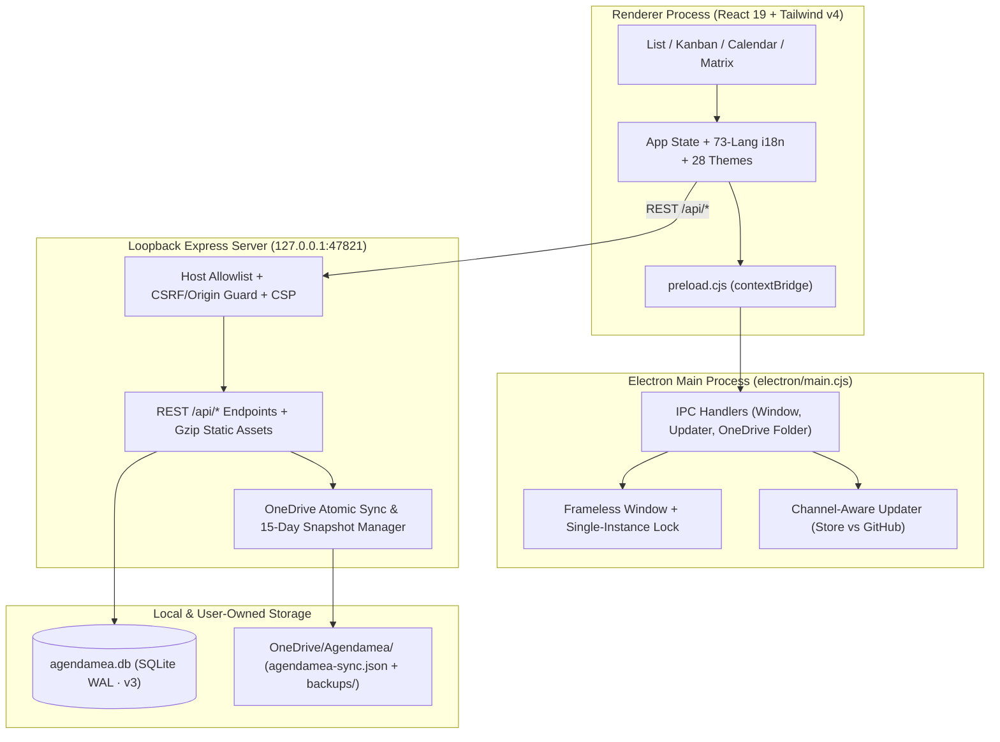

<div align="center">

<a href="https://vellium.dev" target="_blank" rel="noopener noreferrer">
  
</a>

<br /><br />

#  Agendamea - Offline-First Minimalist Task & Daily Planner

</div>

---

<div align="center">

[](#english-version)
&nbsp;&nbsp;&nbsp;&nbsp;
[](#turkish-version)

</div>

---

<div align="center">

[](https://github.com/emirtdede/agendamea/actions/workflows/ci.yml)


</div>

---

<a id="english-version"></a>
# English Version

<div align="center">
  <picture>
    <source media="(prefers-color-scheme: dark)" srcset="public/logos/agendamea-mark-dark.svg" />
    
  </picture>
  <h3>Agendamea - Fast, Offline-First Windows Task &amp; Daily Planner</h3>
  <p><em>4-Way Views (List, Kanban, Calendar, Eisenhower Matrix), Self-Healing SQLite WAL, Zero-Cost OneDrive Sync, 73 Languages &amp; 28 Theme Palettes</em></p>
  <p><strong>Developed &amp; Published by <a href="https://vellium.dev">Vellium</a></strong></p>
</div>

<br>

##  Project Overview

**Agendamea (`v1.0.0`)** is a local-first, offline-first task manager and daily planner built for **Windows Desktop (Electron 45)** and **Progressive Web App (PWA)** environments using **React 19**, **TypeScript 7**, **Express 4**, and **SQLite (`better-sqlite3`)**.

Designed around zero-friction daily planning, Agendamea persists every change - task creation, date ranges, due times, `#tags`, subtasks, auto-saving notes, drag-and-drop ordering, categories, and theme settings - immediately to a local **WAL-mode SQLite** database. No cloud accounts, subscriptions, internet connection, or external telemetry are required.

For cross-device continuity and OS-reinstall safety without vendor lock-in, Agendamea includes **Zero-Cost Serverless OneDrive Cloud Sync**: it writes atomic JSON snapshots and maintains **15-day rolling daily backups** inside your own local Microsoft OneDrive folder, detects existing backups automatically on a fresh installation, and falls back seamlessly to the previous daily snapshot if a primary sync file is ever corrupted.

> **Documentation:** architecture, keyboard shortcuts, 73-language localization, release process, and Microsoft Store packaging checklists are indexed in [`docs/README.md`](docs/README.md).

---

##  Key Features

###  4-Way Workspace Views & Daily Planning
- **Flat List View**: Smart views (`All`, `Today`, `Important`, `Completed`), custom categories with 8 curated colors + custom HEX picker, pinning, instant search, and drag-and-drop or `Alt+Up/Down` keyboard ordering.
- **Kanban Board**: Group tasks dynamically by **Priority** (`High`, `Normal`, `Low`) or **Status** (`Active`, `Completed`) with drag-and-drop transitions and optional drag lock protection.
- **Calendar Planner**: Monthly calendar grid with chronological `HH:mm` time sorting per day and a collapsible **Undated Tasks** drawer supporting drag-to-schedule directly onto dates.
- **Eisenhower Matrix**: Automatic 4-quadrant classification (`Q1 Urgent & Important`, `Q2 Important`, `Q3 Urgent`, `Q4 Later`) with drag-and-drop reprioritization across quadrants.
- **Rich Task Details**: Optional start/due date ranges (`YYYY-MM-DD`), optional due times (`HH:mm`, auto-assigning today when date is empty), post-creation `#tag` management (batch entry, deduplication, 12-tag limit, instant chip filtering), ordered inline subtasks, and auto-saving notes with `keepalive` unmount flush.

###  Self-Healing SQLite Engine & Safe Recovery
- **WAL-Mode SQLite (`better-sqlite3`)**: Runs with `journal_mode = WAL`, `synchronous = NORMAL`, `foreign_keys = ON`, `busy_timeout = 5000`, and versioned migrations (`PRAGMA user_version = 3`).
- **Corruption Self-Healing**: If a local database file is damaged by power loss, Agendamea automatically preserves the broken file as `.corrupt-<timestamp>.bak` and initializes a clean database rather than crashing on startup.
- **Soft-Delete Trash & 12-Second Undo**: Deleted tasks and categories move to a recoverable Trash bin paired with a **12-second Undo toast** that automatically pauses its countdown on hover or focus.
- **Atomic JSON Backup & Restore**: One-click export (`/api/export`) and validated atomic import (`/api/import`, strict 5 MB cap, preview confirmation before overwrite).

###  Zero-Cost Serverless OneDrive Cloud Sync
- **Automatic Local OneDrive Detection**: Discovers `OneDriveCommercial`, `OneDriveConsumer`, `OneDrive`, or user-selected folders and stores sync files under `Agendamea/agendamea-sync.json`.
- **Crash-Safe Atomic Writes & 15-Day Rolling History**: Writes via temporary `.tmp` swap and keeps daily history under `Agendamea/backups/agendamea-YYYY-MM-DD.json`.
- **Corrupt-Primary Fallback**: If `agendamea-sync.json` is truncated or damaged during sync, restoring automatically falls back to the latest valid daily snapshot.
- **First-Launch Reinstall Recovery Banner**: On a freshly installed or formatted PC with an empty local database, Agendamea detects existing OneDrive backups and prompts to **Restore Backup** or **Start Fresh**, plus a one-click **Open Folder** button in Settings.

###  28 Theme Palettes & 73-Language Catalog
- **14 Dual-Mode Color Themes (28 Palettes)**: `Obsidian`, `Slate`, `Navy`, `Blue`, `Cyan`, `Indigo`, `Purple`, `Pink`, `Red`, `Orange`, `Yellow`, `Emerald`, `Grass`, and `Lime` across Light and Dark modes with anti-FOUC `localStorage` caching.
- **73 Fully Localized Languages (Zero Leakage)**: Complete UI localization across 73 languages with OS display-locale auto-detection on first launch and full **RTL** mirroring for Arabic (`ar`), Persian (`fa`), Hebrew (`he`), and Urdu (`ur`).
- **5 Built-In Localized Legal Documents**: Privacy Policy, Terms of Service, KVKK / GDPR Notice, Open Source Licenses, and Accessibility Statement accessible offline inside Settings.

###  Hardened Localhost Security & Native Windows Integration
- **Loopback Isolation & CSRF Defense**: Server binds exclusively to `127.0.0.1` (`47821` with automatic Hyper-V/WinNAT `EACCES` port fallback), enforces Host DNS-rebinding allowlists, validates `Sec-Fetch-Site` and `Origin` headers on state-changing requests, and ships strict security headers (`CSP`, `nosniff`, `SAMEORIGIN`, `no-referrer`).
- **Gzip-Cached Static Assets**: Production `dist/` bundles are served with built-in `node:zlib` memory-cached gzip compression for instant startup and low memory overhead.
- **Native Electron 45 Shell**: Single-instance lock (`requestSingleInstanceLock`), frameless custom window controls, context-isolated preload bridge (`contextIsolation: true`, `nodeIntegration: false`), external URL allowlist (`vellium.dev`, `github.com`), and channel-aware update handling (`isWindowsStore` compliant).

---

##  Tech Stack

<div align="center">


</div>

### Desktop & Local Backend
- **Electron 45.4 & electron-builder 26.18**: Frameless Windows desktop shell, single-instance lock, NSIS installer, Portable build, and Microsoft Store `.appx`/MSIX packaging
- **Express 4.21 & Node.js 22+**: Loopback REST API (`127.0.0.1:47821`) with gzip-cached SPA delivery, CSRF/Origin guards, and OneDrive folder sync endpoints
- **better-sqlite3 13.2**: High-throughput synchronous SQLite engine with WAL journaling, `user_version` migrations, and automatic corruption recovery

### Frontend & UI
- **React 19 & TypeScript 7**: Modular component architecture (`Sidebar`, `QuickAddBar`, `TodoItem`, `TaskBoardViews`, `TodoDetailPanel`, `SettingsModal`, `ErrorBoundary`)
- **Tailwind CSS v4 & `themes.ts`**: 14 dual-mode CSS token palettes (28 total) with anti-FOUC initialization
- **Vite 8 & `vite-plugin-pwa`**: Fast client bundling and offline Workbox service worker

### Build, Test & Release
- **Node.js `node:test` via `tsx`**: Unit tests covering filtering, sorting, tags, date ranges, 73-language zero-leakage validation, and repo-wide typography/hygiene checks
- **esbuild 0.28 & sharp 0.35**: Standalone server bundler (`dist-server/server.mjs`) and automated multi-platform icon/NSIS bitmap generation
- **GitHub Actions**: Automated CI (`ci.yml`) and tagged Windows release pipeline (`release.yml`) with SHA-256 checksums

---

##  Project Structure

```tree
Agendamea/
├── .github/workflows/
│   ├── ci.yml                       # Automated tests, TypeScript lint & build checks
│   └── release.yml                  # Tagged Windows x64 Setup, Portable, Store .appx & SHA256SUMS
├── assets/
│   ├── vellium-banner.svg           # Monochrome Vellium header banner
│   └── icons/                       # Monochrome 20x20 documentation SVG icons
├── docs/                            # Indexed architecture, i18n, release & Store documentation
│   ├── README.md                    # Documentation hub
│   ├── architecture/                # System architecture, API, security & keyboard shortcuts
│   ├── i18n/                        # 73-language localization & RTL specification
│   ├── release/                     # Release pipeline, versioning & update channel docs
│   └── store/                       # Microsoft Store packaging & submission checklist
├── electron/
│   ├── main.cjs                     # Electron main process, single-instance lock, IPC & updater
│   └── preload.cjs                  # Context-isolated renderer IPC bridge
├── electron-resources/              # NSIS installer icons, bitmaps, installer.nsh & APPX tiles
├── public/                          # PWA manifest icons, Windows tiles & Agendamea SVG/PNG logos
├── scripts/
│   ├── build-server.mjs             # esbuild production server bundler
│   ├── build-windows.bat            # Windows local build script
│   ├── create-windows-shortcut.ps1  # Windows shortcut helper
│   ├── generate-icons.mjs           # Sharp multi-platform icon generator
│   ├── generate-installer-assets.mjs# NSIS sidebar & header BMP generator
│   └── start-app.bat                # Local Windows launcher
├── src/
│   ├── api/client.ts                # Typed REST API client
│   ├── components/                  # UI views, Kanban/Calendar/Matrix boards, Detail & Settings
│   ├── db/database.ts               # TodoDatabase (SQLite WAL, migrations, CRUD, backup/restore)
│   ├── hooks/                       # useOnlineStatus, useToast, useTodayDate, useDelayedFocus
│   ├── i18n/                        # 73-language catalog, compact builder, RTL & legal documents
│   ├── utils/                       # themes.ts, todoLogic.ts, todoLogic.test.ts, id.ts
│   ├── App.tsx                      # Root application state, shortcuts & layout
│   ├── main.tsx                     # React 19 entry point
│   └── types.ts                     # Shared domain models
├── server.ts                        # Express loopback REST API, OneDrive sync & gzip static server
├── electron-builder.yml             # Windows NSIS, Portable & Microsoft Store APPX packaging config
├── vite.config.ts                   # Vite 8 + Tailwind v4 + VitePWA configuration
├── CHANGELOG.md                     # Version history (v1.0.0)
├── LICENSE                          # MIT License (Vellium Teknoloji Anonim Sirketi)
└── package.json                     # Scripts, dependencies & v1.0.0 metadata
```

---

##  Architecture & Security Boundaries



**Security model.** The renderer never receives Node.js privileges (`contextIsolation: true`, `nodeIntegration: false`, `sandbox: true`). External links are strictly limited to an explicit domain allowlist (`vellium.dev`, `github.com`). The embedded Express API listens strictly on loopback (`127.0.0.1`), blocks DNS rebinding via `Host` validation, enforces `Sec-Fetch-Site` / `Origin` CSRF checks on all mutations, caps import payloads at `5 MB`, and performs all file/database writes atomically without sending any telemetry or user data to third-party servers.

---

##  Storage & Security Schema

| Path / Boundary | Protection | Contents |
| :--- | :--- | :--- |
| `%APPDATA%\Agendamea\data\agendamea.db` | SQLite WAL, `foreign_keys = ON`, `.corrupt-*.bak` recovery | `categories`, `todos`, `subtasks`, and `settings` tables (`user_version = 3`) |
| `<OneDrive>\Agendamea\agendamea-sync.json` | Atomic `.tmp` rename swap, schema validation | Optional serverless cross-device sync snapshot |
| `<OneDrive>\Agendamea\backups\` | 15-day rolling retention, corrupt-primary fallback | Daily snapshots (`agendamea-YYYY-MM-DD.json`) |
| Loopback API (`127.0.0.1:47821`) | Host allowlist, CSRF/Origin guard, CSP, 5 MB limit | Local REST CRUD, export/import, and OneDrive sync routes |
| Renderer <-> Main IPC | `contextIsolation`, `preload.cjs` allowlisted channels | Window controls, update checks, and OneDrive folder explorer |

---

##  Installation & Usage

### Installing as an End User (Windows)

1. Download **`Agendamea-Setup-1.0.0-win-x64.exe`** (or portable **`Agendamea-Portable-1.0.0-win-x64.exe`**) from [GitHub Releases](https://github.com/emirtdede/agendamea/releases), or install via the Microsoft Store package.
2. Run the setup file. **No administrator (UAC) elevation is required** - it installs per-user (`asInvoker`, `perMachine: false`) into `%LOCALAPPDATA%\Programs\Agendamea`.
3. Choose your preferred install location in the custom Vellium setup wizard.
4. Launch **Agendamea** from the Start Menu or Desktop shortcut.

**SmartScreen on direct GitHub downloads:** For unsigned direct downloads outside the Microsoft Store, Windows SmartScreen may display "Windows protected your PC" on first run. Select **More info -> Run anyway**. The Microsoft Store package is signed by Microsoft and installs without SmartScreen prompts.

**Uninstall:** Windows Settings -> Apps -> Agendamea -> Uninstall. Local user data under `%APPDATA%\Agendamea` is preserved by default (`deleteAppDataOnUninstall: false`) so your tasks remain safe across reinstalls.

### Prerequisites (Building from Source)
- **Windows 10 (1809+) or Windows 11** (64-bit) for desktop builds (or Linux/macOS for web/PWA development)
- **Node.js 20+** (Node.js 22 recommended) and **npm**
- **Git**

### Step-by-Step Developer Setup

```bash
# 1. Clone the repository
git clone https://github.com/emirtdede/agendamea.git
cd agendamea

# 2. Install dependencies
npm install

# 3. Run unit tests & TypeScript check
npm test
npm run lint

# 4. Start development mode
npm run dev           # Web + API dev server (http://localhost:3000)
npm run electron:dev  # Electron desktop mode
```

### Build Windows Packages

```bash
# Production frontend + esbuild server bundle
npm run build

# Windows x64 NSIS Setup + Portable builds (release/)
npm run dist:win

# Microsoft Store APPX/MSIX package (release/)
npm run dist:win:appx

# Unpacked verification build (release/win-unpacked/)
npm run dist:win:dir
```

---

##  Distribution Packages

Build outputs are generated inside `release/`:

- **NSIS Setup Installer** - `Agendamea-Setup-1.0.0-win-x64.exe`
- **Portable Executable** - `Agendamea-Portable-1.0.0-win-x64.exe`
- **Microsoft Store Package** - `Agendamea-Store-1.0.0-win-x64.appx`
- **Unpacked Build** - `release/win-unpacked/` via `npm run dist:win:dir`
- **Checksums** - `SHA256SUMS.txt` generated automatically by GitHub Actions on tagged releases

Published installers and release notes are available on the [GitHub Releases](https://github.com/emirtdede/agendamea/releases) page.

---

##  License & Publisher

**MIT License.** Copyright © 2026 **Vellium Teknoloji Anonim Şirketi**.

See [`LICENSE`](LICENSE) for the full MIT license text. Distributions delivered through the Microsoft Store are also subject to the Microsoft Store Standard Application License Terms.

- **Publisher:** Vellium Teknoloji Anonim Şirketi ([Company Information](https://vellium.dev/en/legal/company-information))
- **Official Website & Repository:** [vellium.dev](https://vellium.dev) &bull; [GitHub Repository](https://github.com/emirtdede/agendamea)
- **Legal Hub:** [Privacy Policy](https://vellium.dev/en/legal/privacy) &bull; [Terms of Service](https://vellium.dev/en/legal/terms) &bull; [Support Policy](https://vellium.dev/en/legal/support) &bull; [Security Disclosure](https://vellium.dev/en/legal/security-disclosure) &bull; [KVKK Notice](https://vellium.dev/en/legal/kvkk-notice)
- **Official Emails:** General [contact@vellium.dev](mailto:contact@vellium.dev) &bull; Support [support@vellium.dev](mailto:support@vellium.dev) &bull; Privacy [privacy@vellium.dev](mailto:privacy@vellium.dev) &bull; Legal [legal@vellium.dev](mailto:legal@vellium.dev) &bull; Security [security@vellium.dev](mailto:security@vellium.dev)
- **Official Social & Community Channels:** [GitHub @VelliumHQ](https://github.com/VelliumHQ) &bull; [LinkedIn](https://www.linkedin.com/company/vellium/) &bull; [X @VelliumDev](https://x.com/VelliumDev) &bull; [Product Hunt @vellium](https://www.producthunt.com/@vellium) &bull; [Instagram @velliumdev](https://www.instagram.com/velliumdev/) &bull; [Threads @velliumdev](https://www.threads.com/@velliumdev) &bull; [Reddit u/VelliumDev](https://www.reddit.com/user/VelliumDev/) &bull; [Discord](https://discord.gg/ur9KBZBEdj)

---

<br>

---

<a id="turkish-version"></a>
# Türkçe Versiyon

<div align="center">
  <picture>
    <source media="(prefers-color-scheme: dark)" srcset="public/logos/agendamea-mark-dark.svg" />
    
  </picture>
  <h3>Agendamea - İnternetsiz Çalışan Sade ve Hızlı Windows Görev Yöneticisi</h3>
  <p><em>4 Farklı Görünüm (Liste, Kanban, Takvim, Eisenhower Matrisi), Kendini Onaran SQLite WAL, Ücretsiz OneDrive Eşitleme, 73 Dil ve 28 Tema Paleti</em></p>
  <p><strong>Geliştirici ve Yayıncı: <a href="https://vellium.dev">Vellium</a></strong></p>
</div>

<br>

##  Proje Genel Bakışı

**Agendamea (`v1.0.0`)**, **React 19**, **TypeScript 7**, **Express 4** ve **SQLite (`better-sqlite3`)** ile geliştirilmiş; hem **Windows Masaüstü (Electron 45)** hem de **PWA** olarak çalışan, tamamen çevrimdışı öncelikli (offline-first) günlük görev ve ajanda yöneticisidir.

Sıfır sürtünmeli günlük planlama için tasarlanan Agendamea; oluşturduğunuz görevleri, başlangıç/bitiş tarihlerini, saat bilgisini, `#etiket` listelerini, alt görevleri, otomatik kaydedilen notları, sürükle-bırak sıralamasını ve tema tercihlerinizi anında yerel **WAL modlu SQLite** veritabanına kaydeder. Bulut hesabı, abonelik, internet bağlantısı veya telemetri gerektirmez.

Cihazlar arası süreklilik ve format sonrası veri güvenliği için **Sunucusuz ve Ücretsiz OneDrive Bulut Eşitleme** sunar: kendi yerel Microsoft OneDrive klasörünüze atomik JSON yedekleri ve **15 günlük döngüsel tarihli yedekler** yazar, temiz kurulum sonrası mevcut yedeği ilk açılışta otomatik algılayarak geri yükleme önerir ve ana dosya bozulsa bile bir önceki sağlıklı günlük yedeğe otomatik geçiş yapar.

> **Dokümantasyon:** mimari, klavye kısayolları, 73 dil desteği, sürüm süreci ve Microsoft Store kontrol listesi [`docs/README.md`](docs/README.md) içinde indekslenmiştir.

---

##  Öne Çıkan Özellikler

###  4 Farklı Çalışma Görünümü ve Günlük Planlama
- **Düz Liste Görünümü**: Akıllı görünümler (`Tümü`, `Bugün`, `Önemli`, `Tamamlananlar`), 8 hazır renk + özel HEX seçicili kategoriler, sabitleme, anlık arama ve sürükle-bırak veya `Alt+Yukarı/Aşağı` ile klavye sıralama.
- **Kanban Panosu**: Görevleri **Önceliğe** (`Yüksek`, `Normal`, `Düşük`) veya **Duruma** (`Aktif`, `Tamamlanan`) göre dinamik sütunlarda yönetme, sürükle-bırak ile geçiş ve sürükleme kilidi desteği.
- **Takvim Planlayıcı**: Gün içi saatlere (`SS:dd`) göre kronolojik sıralanan aylık takvim ızgarası ve tarihsiz görevleri doğrudan takvim gününe sürükleyerek planlayabileceğiniz daraltılabilir **Tarihsiz Görevler** çekmecesi.
- **Eisenhower Matrisi**: 4 kadranlı (`I Acil ve Önemli`, `II Önemli`, `III Acil`, `IV Sonra`) otomatik sınıflandırma ve sürükle-bırak ile öncelik aktarımı.
- **Zengin Görev Detayları**: İsteğe bağlı başlangıç/bitiş tarih aralığı (`YYYY-AA-GG`), saat planlama (`SS:dd`, tarih boşsa bugünü otomatik atar), görev oluşturulduktan sonra eklenebilen `#etiket` sistemi (çoklu giriş, tekrar engelleme, 12 etiket sınırı, tek tıkla filtreleme), sıralı alt görevler ve kapanışta `keepalive` güvenceli otomatik kaydedilen notlar.

###  Kendini Onaran SQLite Motoru ve Güvenli Geri Yükleme
- **WAL Modlu SQLite (`better-sqlite3`)**: `journal_mode = WAL`, `synchronous = NORMAL`, `foreign_keys = ON`, `busy_timeout = 5000` ve sürüm takipli şema göçleri (`PRAGMA user_version = 3`).
- **Bozulma Koruması**: Ani elektrik kesintisinde veritabanı zarar görürse uygulama çökmez; bozuk dosya `.corrupt-<zaman>.bak` olarak saklanır ve temiz veritabanı otomatik başlatılır.
- **Çöp Kutusu ve 12 Saniyelik Geri Alma**: Silinen görev ve kategoriler Çöp Kutusu'na taşınır; fareyle üzerine gelindiğinde veya odaklanıldığında geri sayımı durduran **12 saniyelik Geri Al** bildirimi sunulur.
- **Atomik JSON Yedekleme ve Geri Yükleme**: Tek tıkla JSON yedek indirme (`/api/export`) ve 5 MB sınırlı, önizleme onaylı atomik geri yükleme (`/api/import`).

###  Ücretsiz ve Sunucusuz OneDrive Bulut Eşitleme
- **Otomatik OneDrive Klasör Algılama**: `OneDriveCommercial`, `OneDriveConsumer`, `OneDrive` veya özel seçilen klasörü algılayıp `Agendamea/agendamea-sync.json` altında eşitleme yapar.
- **Çökme Korumalı Atomik Yazım ve 15 Günlük Tarihli Yedek**: Geçici `.tmp` takasıyla güvenli yazım ve `Agendamea/backups/agendamea-YYYY-AA-GG.json` altında son 15 günün günlük anlık görüntüleri.
- **Bozuk Dosya Otomatik Yedek Düşüşü**: Ana eşitleme dosyası zarar görmüşse geri yükleme sırasında en güncel sağlam günlük yedek otomatik kullanılır.
- **Format Sonrası İlk Açılış Kurtarma Bandı**: Yeni kurulmuş veya formatlanmış bilgisayarda OneDrive'da mevcut yedek tespit edildiğinde kullanıcıya **Yedeği Geri Yükle** veya **Yeni Başlangıç** seçeneği sunulur; Ayarlar'dan tek butonla **Klasörü Aç** yapılabilir.

###  28 Tema Paleti ve 73 Dil Kataloğu
- **14 Çift Modlu Renk Teması (28 Palet)**: Açık ve Koyu modlarda `Obsidian`, `Slate`, `Navy`, `Blue`, `Cyan`, `Indigo`, `Purple`, `Pink`, `Red`, `Orange`, `Yellow`, `Emerald`, `Grass` ve `Lime` paletleri; anti-FOUC `localStorage` önbelleği ile sıfır titreme.
- **73 Tam Yerelleştirilmiş Dil (Sıfır Dil Sızıntısı)**: İlk açılışta Windows/tarayıcı sistem dilini otomatik algılayan 73 dil desteği ve Arapça (`ar`), Farsça (`fa`), İbranice (`he`), Urduca (`ur`) için eksiksiz **RTL** sağdan sola arayüz aynalaması.
- **5 Yerleşik Yasal Belge**: Gizlilik Politikası, Kullanım Koşulları, KVKK / GDPR Aydınlatma Metni, Açık Kaynak Lisansları ve Erişilebilirlik Beyanı çevrimdışı olarak Ayarlar içinde yer alır.

###  Sıkılaştırılmış Yerel Güvenlik ve Yerel Windows Entegrasyonu
- **Loopback İzolasyonu ve CSRF Koruması**: Yalnızca `127.0.0.1` üzerinde çalışır (`47821` portu + Windows Hyper-V/WinNAT `EACCES` otomatik yedek port seçimi), DNS rebinding koruması, `Sec-Fetch-Site` / `Origin` doğrulaması ve katı güvenlik başlıkları (`CSP`, `nosniff`, `SAMEORIGIN`, `no-referrer`) uygular.
- **Gzip Önbellekli Statik Dağıtım**: Üretim `dist/` dosyaları yerleşik `node:zlib` bellek önbellekli gzip sıkıştırmasıyla anında sunulur.
- **Yerel Electron 45 Masaüstü Kabuğu**: Tekil süreç kilidi (`requestSingleInstanceLock`), özel çerçevesiz pencere kontrolleri, izole preload köprüsü (`contextIsolation: true`, `nodeIntegration: false`), dış bağlantı izin listesi ve dağıtım kanalına duyarlı güncelleme kontrolü (`isWindowsStore` uyumlu).

---

##  Kurulum ve Kullanım

### Son Kullanıcı İçin Kurulum (Windows)

1. [GitHub Releases](https://github.com/emirtdede/agendamea/releases) sayfasından **`Agendamea-Setup-1.0.0-win-x64.exe`** (veya taşınabilir **`Agendamea-Portable-1.0.0-win-x64.exe`**) dosyasını indirin ya da Microsoft Store paketini kurun.
2. Kurulum dosyasını çalıştırın. **Yönetici (UAC) izni istenmez** - kullanıcı hesabına (`%LOCALAPPDATA%\Programs\Agendamea`) kurulur.
3. Özel Vellium kurulum sihirbazında dilerseniz farklı bir kurulum dizini seçebilirsiniz.
4. Kurulumdan sonra Başlat menüsü veya Masaüstü kısayolundan **Agendamea**'yı başlatın.

**Doğrudan indirmelerde SmartScreen uyarısı:** Microsoft Store dışından indirilen imzasız paketlerde Windows ilk çalıştırmada "Windows kişisel bilgisayarınızı korudu" uyarısı gösterebilir. **Ek bilgi -> Yine de çalıştır** seçeneğini kullanabilirsiniz. Microsoft Store paketi Microsoft tarafından imzalanır ve bu uyarıyı göstermez.

**Kaldırma:** Windows Ayarlar -> Uygulamalar -> Agendamea -> Kaldır. Görev verilerinizin güvenliği için `%APPDATA%\Agendamea` altındaki yerel veritabanınız kaldırılırken varsayılan olarak korunur.

### Kaynaktan Çalıştırma ve Derleme

```bash
git clone https://github.com/emirtdede/agendamea.git
cd agendamea
npm install

# Test ve Tip Kontrolü
npm test
npm run lint

# Geliştirici Modu
npm run dev           # Web + API sunucusu (http://localhost:3000)
npm run electron:dev  # Electron masaüstü uygulaması

# Windows Kurulum, Taşınabilir ve Store Paket Derleme (v1.0.0)
npm run dist:win
npm run dist:win:appx
```

---

##  Dağıtım Paketleri

Derleme çıktıları `release/` klasörü altında üretilir:

- **NSIS Kurulum Paketi** - `Agendamea-Setup-1.0.0-win-x64.exe`
- **Taşınabilir (Portable) Sürüm** - `Agendamea-Portable-1.0.0-win-x64.exe`
- **Microsoft Store Paketi** - `Agendamea-Store-1.0.0-win-x64.appx`
- **Açık (Unpacked) Derleme** - `release/win-unpacked/` (`npm run dist:win:dir`)
- **Doğrulama Özetleri** - Etiketli sürümlerde GitHub Actions tarafından üretilen `SHA256SUMS.txt`

Yayınlanan paketlere ve sürüm notlarına [GitHub Releases](https://github.com/emirtdede/agendamea/releases) sayfasından ulaşabilirsiniz.

---

##  Lisans ve Yayıncı

**MIT Lisansı.** Copyright © 2026 **Vellium Teknoloji Anonim Şirketi**.

Tam lisans metni için [`LICENSE`](LICENSE) dosyasına bakın. Microsoft Store üzerinden sunulan dağıtımlar ayrıca Microsoft Store Standart Uygulama Lisans Koşullarına tabidir.

- **Yayıncı:** Vellium Teknoloji Anonim Şirketi ([Şirket Bilgileri](https://vellium.dev/tr/yasal/sirket-bilgileri))
- **Resmi Web Sitesi ve Depo:** [vellium.dev](https://vellium.dev) &bull; [GitHub Deposu](https://github.com/emirtdede/agendamea)
- **Yasal Merkez:** [Gizlilik Politikası](https://vellium.dev/tr/yasal/gizlilik-politikasi) &bull; [Hizmet Koşulları](https://vellium.dev/tr/yasal/hizmet-kosullari) &bull; [Destek Politikası](https://vellium.dev/tr/yasal/destek-politikasi) &bull; [Güvenlik Açığı Bildirimi](https://vellium.dev/tr/yasal/guvenlik-acigi-bildirimi) &bull; [KVKK Aydınlatma Metni](https://vellium.dev/tr/yasal/kvkk-aydinlatma-metni)
- **Resmi E-Posta Kanalları:** Genel [contact@vellium.dev](mailto:contact@vellium.dev) &bull; Destek [support@vellium.dev](mailto:support@vellium.dev) &bull; Gizlilik [privacy@vellium.dev](mailto:privacy@vellium.dev) &bull; Hukuk [legal@vellium.dev](mailto:legal@vellium.dev) &bull; Güvenlik [security@vellium.dev](mailto:security@vellium.dev)
- **Resmi Sosyal Medya ve Topluluk Hesapları:** [GitHub @VelliumHQ](https://github.com/VelliumHQ) &bull; [LinkedIn](https://www.linkedin.com/company/vellium/) &bull; [X @VelliumDev](https://x.com/VelliumDev) &bull; [Product Hunt @vellium](https://www.producthunt.com/@vellium) &bull; [Instagram @velliumdev](https://www.instagram.com/velliumdev/) &bull; [Threads @velliumdev](https://www.threads.com/@velliumdev) &bull; [Reddit u/VelliumDev](https://www.reddit.com/user/VelliumDev/) &bull; [Discord](https://discord.gg/ur9KBZBEdj)
